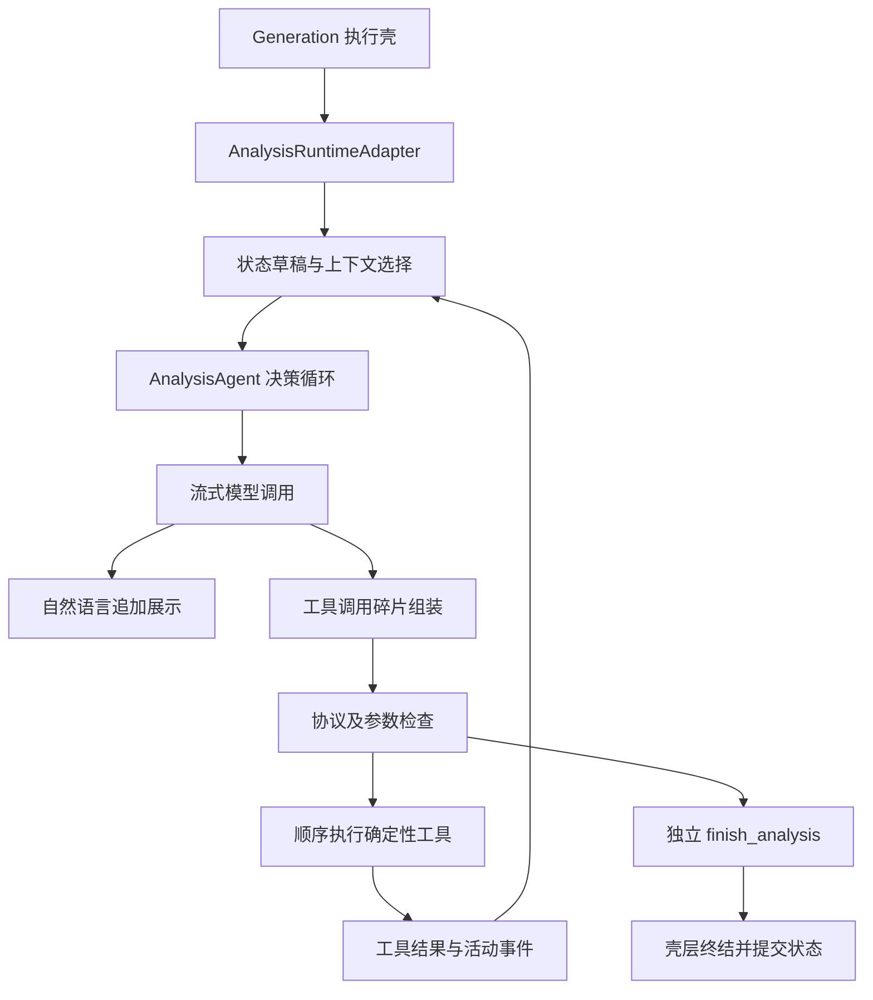

# AI Agent 架构

用途：说明当前 Agent 模式、职责和执行边界。适用读者：Agent 开发、后端与架构维护者。代码级执行见 [Agent Loop 指南](../guides/agent-loop.md)。

## 当前模式

**已确认**：这是使用原生 OpenAI 兼容 Tool Calling 的单 Agent 决策循环，核心为 [AnalysisAgent.run](../../apps/worker/src/analysis/analysis-agent.ts)。没有独立规划 Agent、SQL 修复 Agent、图表 Agent 或模型驱动的工具内子循环。SQL 错误反馈回同一个主循环。

## 三层职责

| 层 | 关键符号 | 负责 |
| --- | --- | --- |
| 执行壳 | Worker ChatService、GenerationService、GenerationReliabilityService | writer fencing、容量租约、心跳、取消、全局超时、持久事件、终结 |
| 运行适配 | AnalysisRuntimeAdapter.run | 授权目录、Memory 快照、分析状态草稿、工具装饰、上下文构建、历史证据、结果元数据 |
| 决策核心 | AnalysisAgent.run | 多轮模型调用、流协议、参数解析、顺序工具执行、文本输出、无进展检测、finish 收尾 |

[Worker ChatService](../../apps/worker/src/chat/chat.service.ts) 和 [Adapter](../../apps/worker/src/analysis/analysis-runtime-adapter.ts) 是依赖边界；不要将队列/SSE生命周期放进核心 Loop。

## 模型自主选择与确定性规则

模型自主决定：问题解释、任务切换、选取 Memory、读取哪些 Schema、时间/筛选/粒度、SQL、验证假设、展示方式、结论和完成状态。

程序强制执行：数据源访问、工具参数和协议、状态 revision、查询前准备状态、SQL 白名单与脱敏、证据来源和条件匹配、Artifact 大小、图表字段类型、状态事务提交、取消和超时。

Prompt 要求比率正确重算、避免 JOIN 放大、验证解释、区分相关性与因果。**这些是模型行为规则，不是 SQL 语义验证器**；state 与 plan 记录意图，不能证明 SQL 实际落实了意图。见 [分析引擎](analysis-engine.md)。

## 工具体系

运行时将 SQL/图表工具包装后，与状态、Schema、Memory、证据工具及 ProposeMemoryTool 注入；`finish_analysis` 由 Loop 直接处理。工具注册事实来源是 [Adapter](../../apps/worker/src/analysis/analysis-runtime-adapter.ts) 与 [analysisTools](../../apps/worker/src/analysis/analysis-tools.ts)，查询定义见 [工具参考](../reference/tools-and-contracts.md)。

单次响应可返回多项调用，但按顺序执行；`update_analysis_state` 和 `finish_analysis` 必须单独成批，否则反馈参数错误。一次工具批次必须拥有完整且唯一的 call ID；上下文选择不能拆开调用与对应结果。

## 完成和错误

- 完成状态分 complete、partial、awaiting_clarification、unable_to_complete；均可能是执行层 completed。业务未能回答和基础设施失败是不同维度。
- 正文实时输出；结束必须独立调用 finish。只有展示了图/表且用户明确只要图/表时，才允许无最终文字结论完成。
- 中文提问默认中文；主要英文正文会被暂缓，必要时一次语言修正。非中文场景不等同于全面多语言校验。
- 同一连续工具参数重复三次报 ANALYSIS_NO_PROGRESS；同 SQL 与错误码失败两次后阻止继续重复该 SQL。
- 上下文长度异常仅在该请求尚无输出时缩小预算重试一次。没有固定最大模型轮数；壳层时间和协议边界负责限制。
- SQL 安全拒绝或数据源访问变化会停止分析并返回 unable_to_complete；其他执行错误通常使 generation failed。取消、writer 丢失、模型失败等分类见共享错误码。

## 上下文与可恢复性

模型每轮接收规则、当前问题、状态数据，以及预算内工具批次、最多四个成功历史 Turn 和目录。跨轮显式状态通过草稿提交；跨会话知识通过数据源 Memory 复用。断流恢复依赖持久事件/消息快照，**不是重建模型栈继续生成**。

持久化 `llm_messages` 是本轮协议记录，不是下一轮直接全量 replay 的输入；raw reasoning 可能随协议保留，但不发送用户 UI 事件。保存政策及敏感性见 [待确认问题](../guides/risks-and-open-questions.md)。
