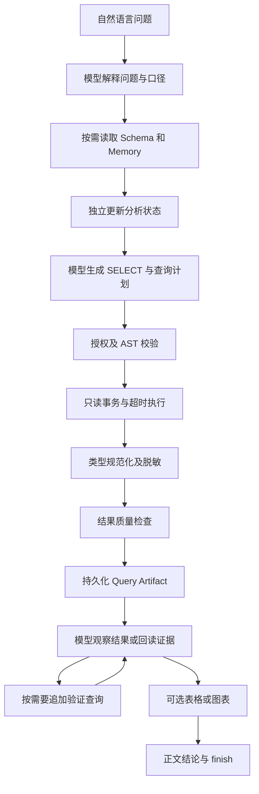

# 数据分析引擎与证据设计

用途：解释自然语言分析到结果交付的职责、约束和可信度边界。适用读者：Agent、数据分析与服务端开发。

## 主链路

这是一条典型路径，模型可按问题选择读取/澄清/回答；不是每问必走的固定工作流。

## 查询契约与安全

[SqlQueryTool](../../apps/worker/src/chat/tools/sql-query.tool.ts) 要求 title、sql、plan（purpose、expectedGrain、expectedShape）。这些用于证据记录及质量提示，不负责把状态自动编译为 SQL。

[SqlExecutor](../../apps/worker/src/chat/tools/sql-executor.ts) 使用 `node-sql-parser` PostgreSQL AST：只允许单条 SELECT；校验 CTE/子查询表范围、schema、写入/锁定和特定危险函数。受限列策略允许 allow、mask、deny；mask 只允许普通 SELECT 直接字段输出，禁止通过表达式、聚合、筛选、排序或 JOIN 条件泄露原值。

[DatabaseClient.queryReadOnlyWithFields](../../packages/database/src/index.ts) 使用专用 Agent pool，BEGIN READ ONLY、statement_timeout 15 秒、结束 ROLLBACK；AbortSignal 尝试 pg_cancel_backend。应用角色最小权限和 AST 是不同防线，不能互相替代。

## 结果边界

| 边界 | 当前机制 | 含义 |
| --- | --- | --- |
| 查询返回行 | SQL 外层 LIMIT 1000 | 保存的是有界结果，不是任意完整数据集 |
| 模型看到的行 | 活跃分析上下文最多约 16,000 字符行 JSON | 可少于 Artifact 行数；标记工具结果截断 |
| Artifact 大小 | result_rows 规范 JSON 最多 5 MiB | 超过拒绝保存 |
| 回读证据 | 每页 20 行，行 JSON 最多 16,000 字符 | 分页子集不应作为重聚合全集 |
| 前端行读取 | 默认 50，最多 100 行/请求 | 只分页存储结果，不重新查询数据库 |

`total_row_count` 存在于 Schema，但现有查询工具不额外 COUNT 填充，不能把 returnedRowCount 当真实总体。`isLimited` 当前通过 SQL 文本首个 LIMIT 与返回行数推算，嵌套 LIMIT 可能影响准确性，见 [问题记录](../guides/risks-and-open-questions.md)。

PostgreSQL 字段 OID 和实际值决定 number/date/boolean/string/unknown；不安全整数/无法无损转换的数值保留原值，避免图表将其误当数值。

## 质量与证据

[assessResultQuality](../../apps/worker/src/chat/result-quality.ts) 计算空值率、空结果、结果/工具截断、基于 expectedGrain 中字段名的重复键，以及首个日期列的 UTC 范围。blocking 级警告禁止图表与已确认假设使用该证据。当前并无通用统计推断、关联基数证明或事实断言校验器。

Query Artifact 保存原 SQL、实际执行 SQL、列类型、返回行、内容哈希、查询计划、质量、分析状态/Memory 快照和访问指纹；Chart Artifact 保存引用与字段映射。两类实体都关联 generation、会话、用户和数据源。数据行由程序读取，模型不能传任意数值数组绘图。

证据复用需同用户、会话、数据源、任务和匹配条件；历史来源必须是 completed Turn。本轮要求最新时只允许本轮查询。比较历史条件需显式 comparison 模式并说明两组条件；不绕过跨任务或时效约束。详见 [状态与上下文](../guides/context-and-state.md)。

## 展示职责

查询本身用于取证，Adapter 抑制未标记 display 的 table 事件；展示表格需要 `display_query_table`。图表只接受本轮已查询或回读的证据，支持 line、bar、pie、scatter、radar、funnel；字段类型、pie/funnel 单数值系列与排序由程序检查。

当前结论主要是模型流式 Markdown，图表/表格按执行顺序插入。最终 analysis 元数据携带状态与采用口径，outcome.blocks 清空以避免重复渲染已交付结果。见 [前端设计](frontend-api.md) 和 [实现指南](../guides/sql-and-artifacts.md)。
