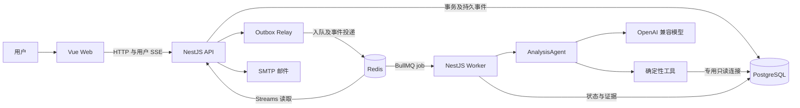

# 系统整体架构

用途：解释部署单元、模块依赖与主要数据流。适用读者：全栈开发、架构和运维人员。

## 工程与技术栈

**已确认**：pnpm workspace 管理 `apps/*`、`packages/*`。版本范围以各 package.json 和锁文件为准，下表只记录技术组成，不作为线上精确版本清单。

| 单元 | 技术与职责 | 核心入口 |
| --- | --- | --- |
| apps/web | Vue 3、Pinia、Vue Router、Vite、Tailwind、reka-ui、ECharts、Markdown | main.ts、router/index.ts、stores/chat.ts |
| apps/api | NestJS、Passport JWT；账号、会话、数据源、Memory、任务创建、SSE、Outbox Relay | main.ts、app.module.ts |
| apps/worker | NestJS、BullMQ；generation 执行、Agent、查询与 Artifact、过期任务监测 | main.ts、chat/chat.module.ts |
| packages/contracts | 执行状态、事件、分析/证据/记忆/Schema 类型、队列载荷解析 | src/index.ts、analysis.ts |
| packages/database | pg 连接、事务、只读查询、Schema、记忆仓库、共享授权与事件持久化 | src/index.ts |
| packages/llm | OpenAI 兼容 Chat Completions、LangSmith 包装、辅助 Prompt | src/index.ts、prompts.ts |
| packages/config | 环境读取、数据库/Worker/JWT 配置 | src/index.ts |

依据：[workspace](../../pnpm-workspace.yaml)、[API Module](../../apps/api/src/app.module.ts)、[Worker Module](../../apps/worker/src/app.module.ts)。

## 两种数据库职责，一套物理连接目标

平台业务表记录用户、任务、状态、记忆和证据；用户分析表保存上传数据或已登记数据。二者职责不同，但目前都位于平台 PostgreSQL 的 `public` 中。`DatabaseClient.getPool` 和查询方法中的 datasourceId 不切换连接。数据源隔离依赖目录、应用访问检查和 SQL AST，不是一源一数据库。

应用连接负责业务写入，Agent 连接负责只读分析。生产环境要求显式配置 Agent 凭据；初始化脚本对目录表授权 SELECT。数据库角色能读取多个源的表，所以用户级隔离仍依赖应用。见 [数据库设计](data-model.md)。

## 主要调用链

1. 前端 `sendMessage` 创建会话（必要时），POST `/api/chat`。
2. API 校验会话和显式数据源访问；事务创建两条消息、generation、Turn、enqueue Outbox。
3. Relay 从 PostgreSQL 获取 Outbox，向 BullMQ `conversation-generations` 入队。
4. Worker 获容量租约、领取 writerToken、开始 Agent；模型选择工具，工具查询授权数据。
5. Worker 将执行事件与投递请求写入数据库。API Relay 转投 Redis Streams；API SSE 读取用户流，前端按 generation.sequence 去重/补洞。
6. Worker 成功终结时同事务提交 generation、Turn、消息及分析状态草稿；表格数据按需从 Artifact API 获取。

**边界说明**：分析任务独立执行，但 API 本身仍会调用 LLM 生成首页问题和字段注释建议。不能把“模型执行在 Worker”扩展为“API 从不调用模型”。

## 外部依赖与部署

[Compose](../../docker-compose.yml) 包括 PostgreSQL 17、Redis 7、API、Worker、Nginx Web 与工具 profile 的 init-db。Nginx `/api/` 代理关闭 buffering，保留 SSE；本地 Vite 将 `/api` 转到 3000。Worker 暴露 `/health`，返回进程标记，未检查数据库、Redis或模型可用性。

LangSmith 由 `wrapOpenAI` 接入；是否启用及实际采集范围取决于环境与依赖，源码不能证明线上链路完整。SMTP 缺失不阻止启动，但找回密码时失败。

## 依赖与维护边界

- Web 依赖 contracts；API/Worker 通过 Nest 服务包装共享 database/llm/config。
- API 与 Worker 都有同名 `ChatService`、`GenerationService`、`SchemaService`，职责不同，查代码必须带应用路径。
- API Schema 有本进程缓存，Worker 按需读取；两者不通过共享缓存同步。
- 可靠性壳层管理排队、所有权、超时和取消；Agent 核心管理模型协议和工具决策。见 [Agent 架构](agent.md)。

源码存在需要维护关注的边界，集中记录在 [问题与证据](../guides/risks-and-open-questions.md)，不在设计图中把未实现能力补齐。
