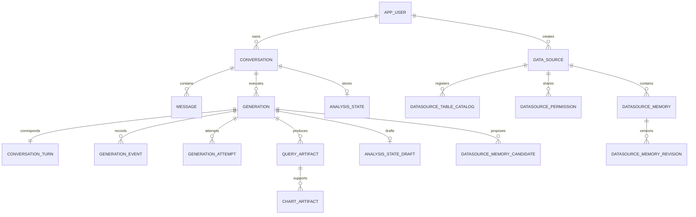

# 平台数据库与核心数据模型

用途：解释核心表为何存在、关键字段在当前代码中的作用，以及数据如何关联、更新和删除。适用读者：后端、Agent、前端和数据库维护者。本文是**关键字段业务语义**的主要维护位置；完整字段、类型和约束见 [数据库参考](../reference/database-schema.md)，一次分析的写表过程见 [数据库持久化指南](../guides/database-persistence.md)。

本文的“已确认”来自当前 DDL 和读写代码，不代表已核验部署中的数据库。字段的当前作用不能证明历史设计理由。

## 1. 平台数据与分析数据

**已确认**：平台使用 PostgreSQL。下面 23 张固定表保存账号、权限、会话、执行、证据和知识。用户分析的数据是同库中登记到目录的物理表，例如上传产生的 `ut_...` 表，字段取决于上传内容，不属于固定平台 Schema。

`data_source` 当前是一个**逻辑表集合和授权范围**，不保存每个源的主机、连接串和数据库凭据。Schema 和 SQL 执行从源 ID 解析可见表，再访问平台配置的 PostgreSQL。业务表、列说明保存在 PostgreSQL COMMENT 中；正式 Memory 与这些注释是不同的数据。

DDL 依据：[CURRENT_SCHEMA_SQL](../../packages/database/src/schema.ts)、[DATASOURCE_MEMORY_SCHEMA_SQL](../../packages/database/src/memory-schema.ts)、[ANALYSIS_STATE_SCHEMA_SQL](../../packages/database/src/analysis-state-schema.ts)。

| 领域 | 固定表 | 解决的问题 |
| --- | --- | --- |
| 账号 | `app_user`、`password_reset_token` | 身份、登录和一次性密码重置 |
| 数据访问 | `data_source`、`datasource_table_catalog`、`datasource_permission`、`datasource_column_policy` | 源范围、物理表注册、共享和字段访问规则 |
| 推荐 | `datasource_suggestions` | 为用户缓存当前源的首页问题 |
| 对话 | `conversation`、`message`、`conversation_turn` | 会话归属、消息展示、成功问答轮次 |
| 执行 | `generation`、`generation_attempt`、`generation_metric`、`generation_trace_span` | 生命周期、写入权、尝试和观测 |
| 投递 | `outbox_event`、`generation_event` | 跨数据库与 Redis 的投递、事件回放 |
| 分析状态 | `analysis_state`、`analysis_state_draft` | 正式状态与当前工作草稿隔离 |
| 分析证据 | `query_artifact`、`chart_artifact` | 查询数据及条件快照、图表字段映射 |
| 业务知识 | `datasource_memory`、`datasource_memory_revision`、`datasource_memory_candidate` | 正式知识、版本历史、待确认提议 |

没有独立 `tool_call` 或“分析报告”表。工具协议保存在 `message.llm_messages`，执行活动保存在消息块和事件中，结果由文本、分析元数据和 Artifact 引用组成。

## 2. 核心关联图

这是业务主关系摘要，不是完整外键图。`data_source.created_by` 可为空；`outbox_event.aggregate_id` 没有 generation 外键，清理依赖 Service 显式删除。`generation_event.conversation_id/message_id` 是定位信息，没有直接外键，其生命周期由 `generation_id` 级联控制。

## 3. 会话、消息与 Turn：同一回答的不同表示

`conversation` 是用户管理和归属校验入口，`message` 是前端恢复页面入口，`conversation_turn` 是 Agent 读取成功问答历史入口。三个层次不能相互替代。

| 表/字段 | 当前用途与读写边界 |
| --- | --- |
| `conversation.user_id` | 会话所有者；列表、消息读取、生成创建、删除校验归属。数据源被共享不会共享会话 |
| `conversation.datasource_id` | 会话默认源；`createTurn` 本次显式源优先，否则沿用它；源删除后设 NULL，执行时还可能解析默认本地源 |
| `conversation.title / updated_at` | 首次提问可把“新对话”改成前 30 字；提交问题更新活动时间供列表排序，不是分析状态 |
| `message.role / content` | 用户 content 保存原文；assistant 创建时为空，成功终结由 `extractFinalAnswer` 汇总 text 块正文。运行中有文字块不意味着 content 已更新 |
| `message.blocks` | 页面展示快照：正文、活动、表格/图表引用、Memory 回执、分析状态元数据、错误等；checkpoint 和 finalize 写入，历史和恢复读取 |
| `message.llm_messages` | 本轮模型协议记录，如 assistant tool_calls 和对应 tool 返回；用于保留执行过程，不是展示块，也不是下轮自动全量重放历史 |
| `conversation_turn.sequence` | 会话问答次序，创建事务中 MAX+1，唯一约束防重复；与逐事件 sequence 属于不同空间 |
| `generation_id / user_message_id / assistant_message_id` | 把一次执行和一对消息连接起来，generation 一对一唯一 |
| `conversation_turn.status / final_answer` | 初始 pending，终结为 completed/failed/cancelled；completed 正文用作历史，失败/取消展示块可保留，但 final_answer 为 NULL |

教学例子：回答包含解释、表格、图表时，content 保存解释，blocks 保存解释和展示引用，llm_messages 保存工具协议，final_answer 保存成功正文供后续历史使用。**正文不是图表数据的完整替代表示。**

下一轮 `AnalysisStateRepository.history` 读取同会话、同源、时间上界以内最近 4 个 completed Turn 的问题和 final_answer，不把过去的完整 SQL 结果和 llm_messages 全部拼回 Prompt。

依据：[ConversationService](../../apps/api/src/conversation/conversation.service.ts)、[GenerationService.createTurn](../../apps/api/src/chat/generation.service.ts)、[checkpointMessage / finalize / extractFinalAnswer](../../apps/worker/src/chat/generation.service.ts)、[AnalysisStateRepository.history](../../apps/worker/src/analysis/analysis-state.repository.ts)。

## 4. generation 与 attempt：执行身份与写入权

`generation.status` 是执行状态，与业务分析是否完整分开。程序正常结束但需要用户澄清时，generation 可以 completed，outcome 为 awaiting_clarification。混淆它们会误判候选可见性和历史复用。

| 字段组 | 当前作用、写入者及约束 |
| --- | --- |
| `user_id / conversation_id / request_message_id / response_message_id` | API 固化身份供 Worker、Artifact、事件和恢复定位；重试接口取出原问题，前端创建新 generation，不复活旧行 |
| `status / started_at / completed_at / error / error_code` | API 创建 pending、请求 cancel_requested；Worker claim 经过 starting/running，最终 completed/failed/cancelled；时间和错误用于排查与终态展示 |
| `idempotency_key / request_hash` | 同用户同键唯一；同键同请求返回原 ID，同键不同摘要拒绝，重复提交不产生另一对消息；request_hash 不是查询结果 hash |
| `writer_token` | claim 时取得随机凭证；草稿、Artifact、checkpoint、事件和 finalize 检查 token 及活动状态，阻止旧执行者继续写；终结时清空 |
| `writer_heartbeat_at` | claim 初始化、运行心跳续期，过期监测据此识别失联；不是用户活动或 SSE 心跳 |
| `cancel_requested_at` | 取消请求时间，排队无 writer 任务也可被监测终结；请求取消不意味着当即完成清理 |
| `last_sequence` | PostgreSQL 保存每个事件加 1，包含 done；用于补洞和快照基线，不是 Redis stream ID，也不是浏览器已收到的数量 |
| `first_token_at` | `markFirstDelta` 设置首个模型 delta 时间并标记 attempt；不单独证明用户已看到第一段完整正文 |
| `datasource_id / context_upper_bound` | 源选择和提交时数据库时间锚点；历史限制 created_at 不越过上界，相对时间以它为锚点；不是业务表数据的数据库快照隔离 |
| `parent_message_id` | 创建时记录最近 completed 的响应消息并带入 Worker 身份；当前 Adapter 不用它驱动分支对话或遍历，不能据此宣称会话树 |
| `reasoning_enabled` | 固化用户推理开关，Worker 结合模型能力使用，不保证所有模型支持 |
| `model_provider / model_name` | API 记录提交时配置用于审计；Worker LLM 服务读取自己的运行配置，当前不按这两列切换单任务模型 |
| 五个 `*_version` | 固化 Prompt、工具集、上下文、Memory、Schema 策略标签；schema_context_version 是实现策略版本，**不是源字段结构内容 hash** |

同会话活动任务部分唯一索引覆盖 pending/starting/running/cancel_requested；用户并发上限由 API 用户事务锁和计数执行。

`generation_attempt.attempt` 在 generation 内递增，writer_token 对应本次 writer，received_first_delta 区分是否有模型输出，status/error/completed_at 在终结或失联回收时更新。**claim、attempt 插入、running 更新是顺序独立操作，不在同一事务**；中途崩溃需要过期监测兜底。它不是当前 UI 的“重试一轮”实体。

依据：[API GenerationService](../../apps/api/src/chat/generation.service.ts)、[Worker GenerationService](../../apps/worker/src/chat/generation.service.ts)、[ChatService.executeGeneration / runGeneration](../../apps/worker/src/chat/chat.service.ts)、[ANALYSIS_RUNTIME_VERSIONS](../../packages/contracts/src/analysis.ts)。

## 5. generation_event 与 outbox_event：事实与投递工作

`generation_event` 保存可回放事实，`outbox_event` 保存把事实投到队列/流的工作请求。数据库已提交而 Redis 尚未收到是允许出现的中间状态。

| 表/字段 | 主要用途 |
| --- | --- |
| `generation_event.sequence / event_type / payload` | `enqueueGenerationEvent` 同事务递增 generation sequence，保存带 eventId、generation/message/conversation ID、occurredAt 的事件；generation+sequence 唯一；history API 按 sequence 补洞 |
| `generation_event.id` | 全表自增 ID；当前逐任务回放使用 sequence，不是浏览器 SSE 游标 |
| `outbox_event.aggregate_id / type / payload` | aggregate_id 约定为 generation ID；活跃写入为 generation.enqueue 和 generation.event，分别投 BullMQ/Redis；Relay 保留 terminal 类型兼容解析分支 |
| `locked_at / lock_token` | Relay 原子认领，SKIP LOCKED 支持多实例；30 秒过期可重新认领；回写带 token 防旧认领者覆盖新认领者 |
| `published_at` | 投递成功标记，不代表浏览器已消费或可以立即清理 |
| `attempts / next_attempt_at / last_error` | 投递计数、指数退避（最长 60 秒）、截短错误；与 generation_attempt 无关 |
| `dead_lettered_at` | INVALID_ 类不可解析事件进入死信，停止自动投递；普通 Redis/队列错误仍可重试 |

同 generation 的 event 仅在不存在更小未发布、非死信 sequence 时可投递，按序处理可投递事件；较小死信记录被排除，后续事件仍可投递，因此逻辑序号可能出现缺口，需要数据库 history 补洞或快照恢复。Redis 以 eventId 去重；PostgreSQL payload.streamId 初始为 0-0，实际 SSE 游标由 Redis 流返回并由 API 填入发送包。

依据：[enqueueGenerationEvent](../../packages/database/src/generation-events.ts)、[OutboxRelayService.dispatch / publishEvent](../../apps/api/src/chat/outbox-relay.service.ts)。通信见 [流式恢复指南](../guides/frontend-streaming.md)。

## 6. analysis_state 与 draft：正式状态和当前工作区

正式表每会话最多一行，草稿表每 generation 最多一行。两者 JSONB 使用 `AnalysisState`，但草稿允许运行中修改，仅 completed generation 可提升正式状态。

| 字段 | 当前作用 |
| --- | --- |
| `analysis_state.conversation_id / revision / generation_id` | 最新已提交状态、提交版本、最后提交者；下轮以此为基础，成功时覆盖，不建立正式状态历史表 |
| `analysis_state_draft.base_revision` | 开始时正式版本，无正式行时为 0；提交时必须仍与正式版本一致，检测跨轮提交冲突 |
| `analysis_state_draft.revision / state.revision` | begin 为 base+1，状态修改和 outcome 落盘继续加 1；正式 revision 可以跳跃，不是每轮只加一次；save 按旧 revision 条件更新 |
| `analysis_state_draft.memories` | 本轮所有 active 正式记忆的全文与版本快照，工具读固定数组，不随管理页编辑实时变化；不含候选 |
| `analysis_state_draft.context_reports` | 每次模型请求的上下文预算、选择报告，排查裁剪，不是继承聊天正文 |

`state` 关键语义如下，类型见 [AnalysisState](../../packages/contracts/src/analysis.ts)：

| JSON 字段 | 业务意义与当前使用方式 |
| --- | --- |
| `taskId / question / datasourceId` | 会话内当前分析任务、问题与源；taskId 可跨 generation 继承，start_new_task 换新 taskId，不能当 generation ID |
| `memoryRefs` | 已选择口径的精确 id+version，必须存在于本轮 Memory 快照，使证据/输出可追溯采用版本 |
| `temporaryNotes` | 本任务临时约定，自动绑定本轮 sourceMessageId；不写正式 Memory，可随任务跨轮继承，新任务重置 |
| `timeRange / comparisonRange` | 带时区半开区间，校验 start 小于 endExclusive，记录分析和比较条件；不自动给 SQL 注入 WHERE |
| `filters / grain` | filters 的 table.column 经授权 Schema 验证；grain 只是非空且长度受限的自由文本，没有 Schema 粒度校验。两者参与证据条件和模型理解，不证明 SQL 已按条件执行 |
| `freshness` | current_generation 要求本轮重新查；reuse_allowed 允许其他条件一致时复用成功历史证据 |
| `hypotheses / openQuestions / status` | 假设、证据、未解问题和业务 outcome；supported/refuted 需可用证据，条件签名变化清空旧假设，最终 status 来自 outcome |

`conditionSignature` 比较 taskId、源、Memory 精确版本、临时约定、两组时间、筛选和粒度，**不比较 revision**；单纯版本加 1 不使相同条件证据失效。freshness 另检。状态是约定与过程记录，尚不是确定性查询编译器。

依据：[AnalysisStateRepository.begin / save / report](../../apps/worker/src/analysis/analysis-state.repository.ts)、[patchAnalysisState / conditionSignature / evidenceMismatch](../../apps/worker/src/analysis/analysis-state.ts)、[promoteAnalysisDraft](../../packages/database/src/analysis-state-schema.ts)。分支案例见 [上下文与状态指南](../guides/context-and-state.md)。

## 7. Query 与 Chart Artifact：证据和展示定义

查询成功会保存证据，即使没有展示表格。图表存字段映射，引用证据，不在 chart 表重复保存业务数据。失败/取消执行中也可能已经产生 Artifact；历史复用另要求所属 Turn completed。

| Query 字段组 | 业务用途与边界 |
| --- | --- |
| `generation_id / user_id / conversation_id / datasource_id` | 固定归属；读时检查用户、会话及当前源权限；源非空，必要时解析默认源 |
| `title / purpose / expected_grain / expected_shape` | 名称和模型查询计划；粒度文本参与重复键启发式检查，形状目前主要作为计划记录，没有强制验证结果满足该形状；不代表计划正确 |
| `original_sql / executed_sql` | 模型 SQL 与验证/限行调整后的实际 SQL，排查以 executed_sql 为准 |
| `columns_json / result_rows` | 规范化并按字段策略处理后的列类型和完整已保存结果；表格 API 切片分页，图表/回读使用同份结果；序列化行超过 5 MiB 拒绝保存 |
| `returned_row_count / is_limited` | 实际保存行数和执行限行标志；受限证据不能用于图表或确认假设，不能把样本推成总体 |
| `total_row_count` | 保留的可选总体行数；当前 SQL 工具不额外 COUNT 填充，通常 NULL，不能宣称精确总体计数 |
| `result_content_hash` | 稳定序列化结果行的 SHA-256，记录内容身份；读回和绘图目前不重算验证；不是 SQL/Schema hash，也不是数据库防篡改证明 |
| `schema_context_version` | Schema 策略标签，不检测字段增删；权限变化检查另用 analysis_context 的 fingerprint |
| `result_quality` | observedRowCount、isLimited、toolResultTruncated、nullRates、可选重复键/时间范围、warnings；blocking 阻断图表/假设确认，warning/info 说明限制 |
| `analysis_context` | 当时完整 state、选中 Memory 全文及版本、accessFingerprint；解释条件并验证复用；指纹由可见表名与字段访问策略计算，不覆盖业务数据变化 |
| `expires_at` | 读取检查过期；当前创建不主动设值，也未发现定时清理 |

`toolResultTruncated` 是模型预览被缩小，`is_limited` 是数据库查询结果受限，两者不同：前者不表示 result_rows 被上下文预算裁掉。质量规则是程序检查，不证明统计结论正确。

`chart_artifact.query_artifact_id` 是数据依赖；chart_type 限六种类型，x_field/y_fields 指真实列和标签，sort 保存排序规则。工具创建前核验证据、字段及 Y 字段列类型是否为 number，前端用 ChartBlock 展示；Query 删除级联关联 Chart。

依据：[ArtifactRepository](../../apps/worker/src/chat/artifact.repository.ts)、[SqlQueryTool](../../apps/worker/src/chat/tools/sql-query.tool.ts)、[GenerateChartTool](../../apps/worker/src/chat/tools/generate-chart.tool.ts)、[ResultQualityV1 / QueryArtifactV1](../../packages/contracts/src/index.ts)、[AnalysisArtifactController](../../apps/api/src/analysis-artifact/analysis-artifact.module.ts)。完整 SQL 机制见 [SQL 与证据指南](../guides/sql-and-artifacts.md)。

## 8. 数据源目录、共享与字段策略

| 表/关键字段 | 当前用途 |
| --- | --- |
| `data_source.created_by` | NULL 源公共可读，当前用户为所有者时可管理；Memory 写严格要求所有者；没有角色等级或每源凭据 |
| `data_source.is_local` | 默认本地源标志，空源 ID 可解析到它，接口禁止删除默认源或向它上传；不是另一种查询引擎 |
| `catalog.schema_name / table_name` | 逻辑源映射物理表，同源+schema+table 唯一；读取限 current_schema，上传用 public；未注册表不自动对 Agent 可见 |
| `display_name / description` | 目录业务名称和描述；列语义主要来自列 COMMENT，目录 description 不是字段字典 |
| `source_type` | preset/uploaded/external 分类；删除表只允许 uploaded，删除源只显式 DROP uploaded 表；external 标签不证明实现远程连接器 |
| `is_agent_visible` | 过滤 Agent 目录与 SQL 可访问表范围 |
| `catalog.created_by` | 上传者/登记者，删除上传表与源所有者共同参与权限校验；不替代源级读授权 |
| `permission.user_id / granted_by` | 同源同用户唯一共享记录和授权者；无 read/write 角色字段，写操作各自检查所有者/上传者 |
| `column_policy.classification` | public/internal/sensitive/restricted 分级元数据，当前查询策略不读取它自动推导权限 |
| `agent_access / mask_type` | 实际 Agent 规则为 allow/mask/deny 与 redact/last4/hash；deny 从可读 Schema 排除并阻止 SQL 引用；mask 在结果处理脱敏，不是业务表存储加密 |

列策略以源/schema/表/列为主键，没直接关联目录行或物理列的外键；删除上传表显式清除对应策略，其他 Schema 变化后有效性需维护。无策略字段沿用代码默认允许行为，classification 单独不是安全屏障。

依据：[DataSourceService.canAccess / uploadTable / remove / deleteTable](../../apps/api/src/datasource/datasource.service.ts)、[getAgentVisibleCatalogTables](../../packages/database/src/index.ts)、[assertDatasourceAccess / getDatasourceColumnPolicies](../../packages/database/src/schema-access.ts)、[SchemaService](../../apps/worker/src/database/schema.service.ts)。上传和注释见 [数据源指南](../guides/datasource-and-schema.md)。

## 9. Memory 主记录、revision 和 candidate

正式正文仅有 name/description，没有独立指标、维度、术语实体或向量表；跨会话复用以 datasource 为界。

| 表/关键字段 | 当前用途和生命周期 |
| --- | --- |
| `datasource_memory.version / status` | 主记录指当前正式版本，active/deleted 控制召回；更新/删除加版本，删除非物理 DELETE |
| `normalized_name` | NFKC、小写、空白归一化标题；同源 active 标题唯一，防标题重复但不判断业务冲突；软删除释放名称 |
| `created_by / created_at / updated_at` | 创建者及时间；授权仍按源所有者，不按此字段允许任意创建者编辑 |
| `revision.memory_id / version / content` | 复合主键存每版全文；编辑追加 revision，旧版可查，不覆盖历史 |
| `revision.status / source / source_message_id / confirmed_by` | 每版状态、manual/conversation 来源、原消息 UUID、确认者；对话来源要求 UUID 非空，但无 message 外键，会话删除仍留 UUID |
| `candidate.generation_id / source_message_id / user_id` | 提议执行、原用户消息和提议用户；仅该 generation completed 后当前用户可见和确认 |
| `candidate.content / memory_id / expected_version` | 候选全文及可选替换目标；新增目标与版本都空，替换须同源 active 目标及正版本；expected_version 是目标 Memory 乐观锁版本 |
| `candidate.version / status` | 候选自身乐观锁版本，初始 1/pending，确认或拒绝加 1，变 accepted/rejected；与 expected_version 是两个空间 |
| `candidate.result_memory_id / result_version` | 确认后正式结果；同动作重复请求可对上一候选版本返回同一回执，避免再写一版 |

正式保存与追加 revision 同事务；确认时正式保存与 accepted 同事务。候选产生和 generation completed 不同事务，以查询状态控制可见性。“记住”直接正式保存独立提交，后续失败/取消不撤销。

依据：[MemoryRepository.save / rememberFromConversation / propose / decide](../../packages/database/src/memory-repository.ts)。入口、相似核对和固定召回见 [Memory 指南](../guides/memory.md)。

## 10. 账号、推荐与执行观测

| 表 | 关键字段及实际机制 |
| --- | --- |
| `app_user` | email 唯一、服务层归一化；password_hash 为 bcrypt 摘要，登录验证与 JWT credentialsVersion 依赖它；name 为显示名；无数据库 session/refresh_token 表 |
| `password_reset_token` | token 实存 SHA-256 摘要，邮件链接用原随机值；expires_at 为 15 分钟，used_at 标一次性失效；重置事务锁用户、检查凭据、更新密码并使该用户其他未用凭据失效；旧 JWT 因密码版本变化拒绝 |
| `datasource_suggestions` | 源+用户主键；questions 是 `{key, items, prompt}` 对象，key 含语言、结构化 Schema 内容 hash、首页 Prompt 元数据；匹配才复用，created_at 是刷新时间而非 TTL；与回答后的追问推荐不同 |
| `generation_metric` | 每 generation 一行，LLM/tool/SQL 次数及输入输出 token **估算**；执行结束 upsert，持久化失败不必然阻断终结；不是服务商计费 usage |
| `generation_trace_span` | name/status/duration_ms/metadata 观测记录；当前主要写 generation.error，错误处理时才传入起始时间，不能作完整任务时长或完整工具 Trace |

依据：[AuthService](../../apps/api/src/auth/auth.service.ts)、[SuggestionService.getSuggestions](../../apps/api/src/datasource/suggestion.service.ts)、[recordExecutionMetrics / recordSpan](../../apps/worker/src/chat/generation.service.ts)、[ChatService.runGeneration](../../apps/worker/src/chat/chat.service.ts)。

## 11. 事务、删除与保留

| 操作 | 同事务内容 | 事务不包含 |
| --- | --- | --- |
| API createTurn | 两消息、generation、Turn、enqueue Outbox、会话更新 | Redis 入队、Worker 执行 |
| 草稿/证据/事件写入 | 各自写入和 generation writer/状态检查；事件另含 sequence 和 Outbox | 整轮所有查询、证据、checkpoint 的统一事务 |
| finalize(completed) | generation 终态、草稿提升、最终消息、Turn、attempt、done 与 Outbox | 已提交 Artifact、Memory 直存、Redis 投递 |
| Memory 确认 | 主记录、revision、candidate 状态/结果 | 重算既有分析、刷新本轮固定快照 |

删除会话以会话事务锁和 generation 行锁先移除 Outbox 再删除会话；级联消息、generation、Turn、Artifact、正式状态/草稿、候选、指标与事件。正式 Memory 留在源中，revision 来源 UUID 可能无法打开原消息。

删除源级联目录、权限、Memory、源 Artifact 和推荐，conversation/generation 源引用 SET NULL；Service 显式 DROP uploaded 表，preset/external 物理表不随目录外键删除。analysis_state JSON 源 ID 无外键，可能仍留旧值，下轮按解析新源创建状态。

未发现 completed 草稿、generation_event、Artifact 的自动数据库清理任务。Redis 流保留期不等于 PostgreSQL 记录寿命。

`DatabaseClient.connect` 调用 assertCurrentSchema 检查 DDL 列基础类型，不自动迁移或完整验证索引/外键/CHECK；applyCurrentSchema 通过 CREATE IF NOT EXISTS 建表并升级 Memory 来源约束，不是任意旧结构修复器。迁移脚本可能删旧结构或分析数据，本次未执行，见 [开发环境指南](../guides/development.md)。
