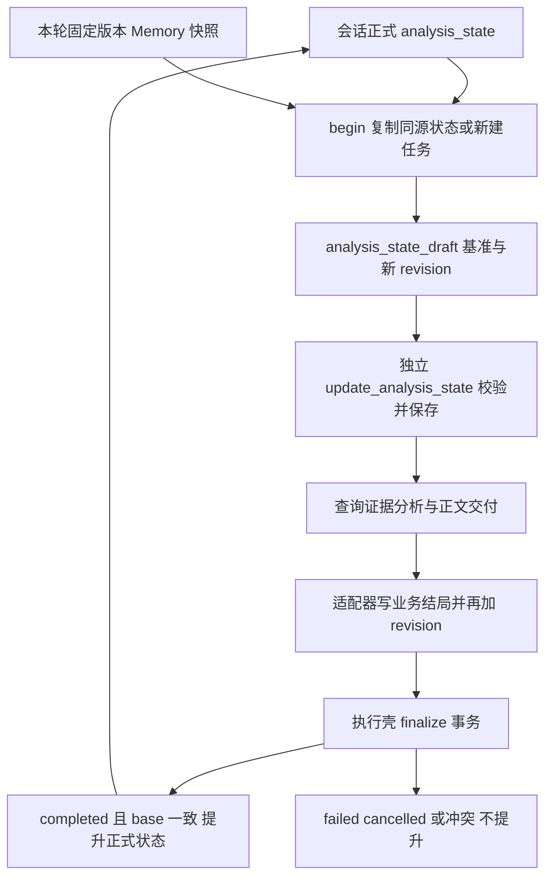

# 分析状态与上下文构建指南

用途：理解“继续刚才分析”“改一个条件”“只重画图”“刷新数据”怎样影响模型输入、证据复用与跨轮提交。适用读者：Agent、分析条件、Memory 和状态持久化开发者。整体知识分层见 [知识与上下文设计](../design/knowledge-and-context.md)，执行循环见 [Agent Loop](agent-loop.md)，事务结束见 [执行生命周期](generation-lifecycle.md)。

下文的业务表、日期、ID、金额和 revision 轨迹均为**教学构造**，不代表真实数据或运行验收；机制与约束直接依据当前源码。

## 1. 四类上下文不能互相替代

| 内容 | 来源 | 用来解决什么问题 | 不能当作什么 |
| --- | --- | --- | --- |
| 会话历史 | completed Turn 的 question/final_answer，最多四轮同源 | 理解“刚才”“再按渠道”等指代 | 可直接复用的精确数据证据 |
| 分析状态 | conversation 的正式状态复制成本轮 draft | 继承问题范围、时间、筛选、粒度、选定口径和假设 | 已经执行正确的 SQL 或长期知识 |
| 正式 Memory | 本轮开始加载的数据源 active 版本快照 | 可复用的业务定义和长期约定 | 本轮临时覆盖，或尚待确认候选 |
| 查询证据 | Query Artifact 及其分析条件、质量、时间 | 支持结论、回读数据、重画图和检验假设 | 自动随数据库更新的实时视图 |

第五类是本轮 `assistant/tool` 协议，它让模型知道“我实际请求了什么、工具实际返回了什么”。这一类要完整保留选中批次，不能截成只有结果 ID 的历史摘要。

例如旧回答说“渠道 A 成交额最高”，只能帮助理解用户的下一句；要重画该结论的图，还必须回读对应 Artifact 并通过适用性检查。Memory 中写“成交额排除退款”属于业务口径；用户本轮说“这次包含退款”应进入临时条件，不能无确认覆盖正式 Memory。

## 2. 草稿从哪里来，何时成为下一轮基础

[AnalysisStateRepository.begin](../../apps/worker/src/analysis/analysis-state.repository.ts) 在事务中先锁 generation 并检查当前 writer。已有本轮草稿时返回它；否则读取会话正式 `analysis_state`：

- 同数据源：复制上轮 state，保留同任务的条件和口径。
- 换数据源：`newAnalysisState` 创建新 taskId 和空条件。
- 无正式状态：base 为 0，建立新状态。
- 无论复制还是新建，draft.revision 都设为 `base_revision + 1`，status 设 active。
- 如果旧 `memoryRefs` 的精确版本不在本轮 Memory 快照中，移除这些引用、清空 hypotheses，并将版本变化提示加入 openQuestions。

`begin` 不会自动将继承状态的 `state.question` 改为新消息。当前问题同时独立保存在 `snapshot.question` 和模型 user 消息里；模型需要通过 `update_analysis_state.patch.question` 显式更新工作问题。不能把读到旧 state.question 误判为系统没收到新问题。



数据库 `base_revision` 只在 begin 时记录，描述本轮继承的正式版本；draft `revision` 随 patch 和最终保存递增。这两种版本用途不同：前者防止覆盖别人的跨轮提交，后者防止本轮用过时状态更新。

### 关键状态字段怎样影响分析

完整 TypeScript 定义在 [AnalysisState / AnalysisRunSnapshot](../../packages/contracts/src/analysis.ts)。开发者应优先理解以下字段，而非只记 JSON 形状：

| 字段 | 谁写、什么时候写 | 主要作用 |
| --- | --- | --- |
| `taskId` | 新状态或 `start_new_task` 生成 | 区分同会话中的不同分析任务；改变后旧证据不适用 |
| `revision` | begin、每次成功 patch、最终结局保存 | 乐观版本控制与追踪；证据复用不要求 revision 相等 |
| `question` | 初建或模型 patch | 工作问题描述；不参与条件签名 |
| `memoryRefs` | 模型读定义后选择 `{id,version}` | 固定本次采用的正式口径；版本改变影响证据适用 |
| `temporaryNotes` | 模型 patch，程序绑定本次请求消息 | 本轮临时定义，保存来源；不写长期 Memory |
| `timeRange` / `comparisonRange` | 模型将相对时间解析为明确区间 | 左闭右开范围及业务时区；用于条件声明与复用检查 |
| `filters` | 模型 patch，程序校验字段授权/操作符/值 | 显式条件；不会自动改写 SQL |
| `grain` | 模型 patch，自由文本 | 描述期望分析粒度；不是 SQL GROUP BY 解析结果 |
| `freshness` | 模型 patch | `reuse_allowed` 允许匹配历史；`current_generation` 要求本轮重新查询 |
| `hypotheses` | 模型 patch，程序检验证据 | 记录分析假设及判断；不自动证明文字逻辑成立 |
| `openQuestions` | 模型、Memory 变化提示、最终缺失项 | 后续待确认内容；收尾只在missingItems非空时替换，否则保留，complete不自动清空；不参与条件匹配 |
| `status` | begin/patch 设 active，适配器按 outcome 写结局 | 业务分析阶段，区别于 generation 执行状态 |

`session.prepared` 不在 AnalysisState 中。每轮初始仍为 false；即使继承了上轮完整条件，本轮也必须独立状态更新成功，才能查询、回读或绘图。

## 3. 一次合法状态更新如何读

以下教学参数假定当前 revision 为 1，`orders.channel` 为已授权的真实字段。日期是明确构造的区间，不依赖文档阅读当天：

```json
{
  "expectedRevision": 1,
  "mode": "patch",
  "reason": "确认本轮按渠道比较指定七个完整自然日的成交额",
  "patch": {
    "question": "按渠道比较成交额",
    "timeRange": {
      "start": "2026-10-01T00:00:00+08:00",
      "endExclusive": "2026-10-08T00:00:00+08:00",
      "timezone": "Asia/Shanghai"
    },
    "filters": [{"field": "orders.channel", "operator": "neq", "value": "internal"}],
    "grain": "每行一个渠道",
    "freshness": "reuse_allowed",
    "temporaryNotes": [{"name": "成交额", "description": "本次按金额汇总，包含退款记录"}]
  }
}
```

[patchAnalysisState](../../apps/worker/src/analysis/analysis-state.ts) 不让模型自由写任意字段，它会：

1. 检查 `expectedRevision === current.revision`、mode、reason 和允许字段；不能由模型更改 conversationId/datasourceId/taskId/revision。
2. `patch` 模式复制现状；`start_new_task` 重新生成 taskId、清空旧时间、过滤、口径、假设等，再应用 patch。新任务若没 patch.question，初始化仍沿用当前 state.question，模型应显式更新它。
3. 确认 Memory 引用存在于本轮 active 快照的精确版本，禁止重复引用。
4. 将临时定义自动绑定本轮 `sourceMessageId`，不接受模型伪造来源 ID。
5. 时间要有时区后缀、可解析且 `start < endExclusive`，timezone 必须是有效 IANA 时区；保存时间转换为 ISO UTC，同时保留业务 timezone。
6. filters 的 field 必须形如 `table.column` 且通过当前授权 Schema 检查；操作符限 `eq / neq / gt / gte / lt / lte / in`。`in` 要非空数组，最多 100 个标量；普通条件接受有限标量或 null。格式合法不等于数据库表达式语义已正确实现。
7. 条件签名变化则先清空旧 hypotheses；新假设中的每个 evidence ID 必须是本轮已观察证据，条件匹配、非截断且无 blocking 质量告警；supported/refuted 还要求非空 evidenceIds。
8. revision 加 1，status=active；工具再以旧 revision 为条件保存草稿。保存成功才更新 session.state、`session.prepared=true` 和工具执行上下文。

解析/业务校验失败通常返回 `succeeded=false`、错误和当前 state，模型可用正确版本重试；数据库保存冲突或底层异常不是假装成功的状态更新。普通用户可能看到活动警告，错误反馈会进入下一次模型调用。

如果只是确认沿用所有条件，可合法传 `patch: {}` 和 reason，revision 仍增加，条件签名不变。如果重新提交与上轮文字相同的 temporaryNotes，程序会绑定新的 sourceMessageId；该来源属于签名内容，可能改变证据适用性。不要把“看起来同一句口径”自动当作条件完全相同。

## 4. 状态验证与 SQL 验证的边界

`update_analysis_state` 证明“本轮显式确认了可解析、可授权的条件”，不证明生成的 SQL 落实了它们。当前没有自动将 filters/timeRange/grain 编译为 SQL，也没有把 SQL AST 与 state 做逻辑等价比较。

因此教学请求虽然写了 `orders.channel != internal`，模型仍必须在实际 SQL 中落实过滤。若 SQL 漏条件，安全验证可能通过，Artifact 也会记录这份声明状态；条件签名匹配不构成业务正确性证明。修改分析能力时必须同时看 Prompt、SQL、证据质量和状态记录。SQL 权限与执行边界见 [SQL 与 Artifact 指南](sql-and-artifacts.md)。

假设也有类似边界：系统能要求“支持/反驳的假设引用实际观察、当前条件、质量可接受的证据”，但不会自动判断“渠道下滑由价格导致”是否由这些查询逻辑推出。因果与替代解释仍依赖模型分析及开发者验收。

## 5. 查询证据为什么不是只凭一个 ID 就能复用

查询成功时，SQL 工具把当前 `state`、选中 Memory 和访问 fingerprint 随 Artifact 保存。以后读取需要连续通过几个边界：

1. 当前数据源仍授权；Artifact 属于同用户、同会话和同源。
2. 当前 generation 的 Artifact 可用；历史 Artifact 必须来自 completed Turn，failed/cancelled 的部分查询不能被后续当成功证据。
3. 当前授权表名和字段策略计算的 fingerprint，与证据记录一致；变化则拒绝并要求重查。
4. [evidenceMismatch](../../apps/worker/src/analysis/analysis-state.ts) 检查 taskId、分析条件与 freshness。
5. 要展示图表或确认假设，还要检查截断/质量等用途约束。

`conditionSignature` 包含 taskId、datasourceId、按 ID 排序的 memoryRefs、temporaryNotes、timeRange、comparisonRange、filters、grain；不含 revision、question、status、hypotheses、openQuestions。freshness 另用 generationId 显式检查。

| 变化/要求 | 默认结果 | 开发者应理解的原因 |
| --- | --- | --- |
| 只改图型或正文问题，条件不变 | 历史回读后可复用 | revision/question 不参与签名 |
| 改日期、筛选、粒度、Memory 版本或临时定义 | 不匹配，要求重新查询 | 这些属于查询解释条件 |
| 开始新任务 | 不可复用 | taskId 变了，即使 SQL 看起来相同 |
| freshness=current_generation | 历史证据不适用 | 回读只能读取旧结果，不刷新数据库 |
| 同任务历史条件比较 | 显式 comparison 可回读不同条件 | 只能用于明确比较，不当成当前条件结果 |
| 字段策略/授权表集合变化 | 拒绝回读 | 权限环境变了 |
| Schema描述或实际列变化 | 不能据此保证自动失效 | 这类变化不属于当前 accessFingerprint 的比较内容 |

`read_query_artifact` 默认 current 模式。comparison 模式只在同任务、同源且没有本轮最新要求时放行不同条件，结果含 `comparisonOnly=true`、artifactState 和 currentState。该结果让模型说明“两组条件在比较什么”；它不会让 `generate_chart / display_query_table` 绕过默认匹配检查，也不能把旧数据变成本轮最新结果。

回读每页 20 行，页 JSON 超过 16,000 字符返回可修正错误，要求减字段或聚合。返回 `nextOffset` 不是“结果已经全部读取”；分页子集不能凭空重算总体比率、去重或汇总。

`loadedSchema` hash 记录本轮读到的详情，用于输入追踪，不是证据复用的强制 schema 校验。现有机制不能证明一个跨轮 Artifact 在数据变化后仍新鲜；必须明确使用 freshness 或重查。

## 6. 三轮追问：复用、改条件和回滚

以下示例只假设用户已经接入含日期、渠道、金额的授权表。为让 revision 轨迹可读，每轮只做一次状态 patch；多次 patch 或假设更新会产生更多 revision。

### 第一轮：建立可复用的分析条件

用户：“比较 10 月 1 日到 7 日的渠道成交额，画图并解释。”

| 步骤 | 状态变化 | 数据和持久化 |
| --- | --- | --- |
| begin | 新 task T；base=0，draft revision=1 | 草稿写入固定版本 Memory 快照 |
| 独立 update | 确认绝对日期、渠道粒度和金额定义；revision=2 | 保存成功后 prepared=true |
| SQL | 不改 revision；产生 Artifact A | A 保存查询时 revision=2 的 state、口径、SQL、质量和结果 |
| 图表/正文/finish | delivered、answered 与 complete 收尾 | 事件和消息 checkpoint 保留展示 |
| 适配器收尾 | state.status=complete，revision=3 | 最终草稿仍未等于正式提交 |
| finalize | completed | 同事务提升正式 state revision=3；A 属于可复用成功 Turn |

### 第二轮：相同条件只重画，随后演示条件变更

用户：“条件不变，把刚才的图改成柱状图。”

begin 复制 T，base=3，draft revision=4。模型独立 patch 问题或空 patch 确认沿用，revision=5；保留第一轮绝对时间、口径和筛选，不重新解析“最近七天”。`read_query_artifact(A)` 通过签名检查，进入本轮 observed；下一次模型调用再绘柱状图。

A 记录 revision=2，当前为 5，仍可复用：比较的是条件签名，不是版本号相等。最终保存到 6，finalize 提升；没有新 SQL，也没有把 A 的 queriedAt 改成当前时间。

如果第二轮实际说“只看渠道 A”或“改成 10 月 2 日到 8 日”，模型要改 filters/timeRange，旧假设清空，A 默认不适用，应产生新证据。若目的是同时解释两段时间，才可显式 comparison 回读 A；不能把 comparison 的 A 直接当新条件图表的数据。

### 第三轮：刷新最新数据，与取消不提交

用户：“按刚才的条件，重新刷新数据库最新数据。”

begin 的 base=6，draft revision=7。独立 patch 把 freshness 改为 current_generation，revision=8。此时回读 A 会失败并说明它属于历史 generation；需要实际 SQL 生成 B。相对“最新”描述的是重新查库，不意味着自动扩展已固定的日期区间。

若顺利完成，最终草稿 revision=9 并提交。若 SQL 后或模型结论中途取消：

- 正式状态仍为第二轮 revision=6，不是草稿 7/8。
- 本轮 draft、部分事件、blocks 和 B 可以留存，但 Turn 不进入成功历史，B 不能被后续作为 completed 来源证据复用。
- 用户仍可能看到取消前已流出的文字/图表；停止执行不撤回所有已展示内容。
- 新一轮 begin 从正式 6 继续，重新获取 Memory 快照和时间锚点。
- 若此前有独立确认的正式 Memory 保存，该知识事务不随这次取消回滚。

如果模型合法输出“已完成渠道汇总，缺少成本字段，不能算利润”并 finish partial，这一轮仍可能执行 completed、提交 partial 状态。**不完整的业务回答与失败的执行必须分别判断。**

## 7. 每次模型调用怎样选择有限上下文

[AnalysisRuntimeAdapter.run 提供的 prepareContext 回调](../../apps/worker/src/analysis/analysis-runtime-adapter.ts) 每轮重新生成 analysis-data、历史和目录候选；[assembleContext](../../apps/worker/src/analysis/context-assembler.ts) 做确定性选择。

先把本轮消息切成组。普通消息为单独组；包含工具调用的 assistant 必须与所有对应 tool 结果组成一个不可拆批次。如果缺结果、结果 ID 不匹配或出现孤立 tool，立即 `ANALYSIS_PROTOCOL_ERROR`，不通过删一半协议继续调用模型。

例如以下批次含两个调用，压缩时只能整体保留或整体省略：

```json
[
  {"role": "assistant", "content": null, "tool_calls": [
    {"id": "call_schema_a", "type": "function", "function": {"name": "get_schema", "arguments": "{\"table\":\"orders\"}"}},
    {"id": "call_memory_a", "type": "function", "function": {"name": "read_memory", "arguments": "{\"id\":\"memory-demo\"}"}}
  ]},
  {"role": "tool", "tool_call_id": "call_schema_a", "content": "{\"table\":\"orders\",\"columns\":[{\"name\":\"channel\",\"type\":\"text\"}],\"nextOffset\":null}"},
  {"role": "tool", "tool_call_id": "call_memory_a", "content": "{\"error\":\"当前记忆快照中不存在该 ID\"}"}
]
```

这是合法的协议教学结构，第二个工具失败仍要有结果；不是可以省略失败结果的理由。状态更新和 finish 的独立批次规则仍由 Loop 额外验证。

### 选择优先级与输出顺序不是同一件事

| 选择类别 | priority | 是否必须 | 预算不足的行为 |
| --- | --- | --- | --- |
| 系统规则 + 当前原始问题 | 1 | 是 | 整轮报超预算 |
| 最新 analysis-data | 1 | 是 | 整轮报超预算 |
| 本轮最后消息组、最近完整工具组 | 3 | 是 | 整轮报超预算 |
| 其他本轮互动 | 3 | 否 | 从新到旧选择，输出时恢复原顺序 |
| 最近成功同源 Turn | 4 | 否 | 优先近期；输出历史按时间顺序放在当前问题之前 |
| 表/Memory/历史证据目录 | 5 | 否 | 可省略，再按需工具读取 |

优先选择 required，再按 priority。目录作为一个候选整体选择；不是逐表裁剪到还剩一点预算。选完后的输出是 system、选中历史问答、其他 extra 数据、当前 user 问题、本轮完整互动。因而“分析数据优先级最高”不表示它变成 system 规则，也不表示它必定排在所有历史消息前。

历史只取 completed、同数据源、非当前 generation 且 `generation.created_at <= context_upper_bound` 的最近四 Turn；用问题和 `final_answer`，不重放历史 `llm_messages`。时间上界按 generation 创建时间过滤，不是数据库时间旅行快照，也不表示数据查询固定于该时刻。单会话活动任务限制减少并发混入，但应理解源码筛选的实际字段。

### 预算、退让和失败

[resolveModelCapability](../../apps/worker/src/chat/model-capabilities.ts) 通过模型名称模式给出仓库预算，也允许 `MAX_CONTEXT_TOKENS / RESPONSE_RESERVE_TOKENS` 覆盖；不是提供商官方能力保证。未知模型 fallback 为 32,000/4,000。

首次预算约为：

```text
contextWindow - responseReserve - ceil(contextWindow * 10%)
```

工具定义也占预算。[estimateTokens / estimateMessagesTokens](../../apps/worker/src/chat/token-estimator.ts) 按中文约 1.2 字符/token、其他约 4 字符/token 和消息开销估计，不是提供商实际分词或账单 token。Loop 还会再次估计最终 messages + tool definitions，超过预算直接失败。

若提供商在**没有任何输出**时返回 `context_length_exceeded / max_context_length`，仅一次将预算降至原来的 75%重试并重新选择。已有正文或工具碎片时不会继续这条退让路径，避免把未完成流接成一个假装完整的响应。必选规则/状态/最新工具批次本身过大，则 `CONTEXT_BUDGET_EXCEEDED`，让用户缩小问题，不静默丢掉最新结果。

## 8. 如何追踪“模型当时到底看到什么”

每次选择报告包含 candidateId、category、priority、估算 token、selected/omittedReason 和内容 hash。适配器 `onContext` 将 report 追加到草稿 `context_reports`；最终 analysis 元数据同时包含这些报告和证据条件。

快照还记录运行策略版本、Prompt version/hash、generationId、模型配置名、本轮问题、stateRevision、Memory refs、已加载 Schema hash、Artifact IDs、选中的历史 Turn IDs、时间锚点及估计器名称。

这些记录可以回答“某条历史是否被预算省略、使用了哪个 Memory 版本、证据对应哪版条件”，但不是提供商完整请求逐字审计日志。报告 hash 不保存原内容；恢复完整语义仍需对应状态、Memory 快照、消息协议和源码 Prompt。部分记录因任务失败或尚未 checkpoint 未进入最终展示元数据，排障也需看草稿及事件。

## 9. 修改入口与检查顺序

| 想修改的内容 | 应同时核对的代码/影响 |
| --- | --- |
| 增加状态字段 | `AnalysisState`、`newAnalysisState`、patch允许字段与校验、工具JSON schema、Prompt、条件签名、最终依据展示；判断是否影响证据适用性 |
| 改变追问继承 | begin 同源复制、question更新、Memory版本过滤和 start_new_task；用保留/替换/新任务三个场景分别推演 |
| 修改证据复用 | `conditionSignature / evidenceMismatch`、readEvidence权限、历史 completed检查、comparison与展示包装；不得只去掉一个 mismatch |
| 调整上下文大小/排序 | `assembleContext`、预算估计和 ModelCapability；保留工具完整批次、当前问题和必选数据 |
| 改历史轮数 | `AnalysisStateRepository.history` 的筛选与排序、适配器 extras；不能默认改成全量协议重放 |
| 改 Memory 召回 | 本轮active快照、目录分页、精确读取和 memoryRefs；当前无向量检索，文本相似查重不是检索召回 |
| 改跨轮提交 | draft.save、`promoteAnalysisDraft` 与 finalize同事务；失败、取消、冲突必须维持不提升 |

排查追问不正确时，依次看：当前原始问题是否正确；draft 是否继承期望数据源/task；Memory版本是否被移除；状态 patch是否成功；SQL是否真实落实条件；Artifact条件和质量是否适用；上下文 selection是否保留了必要批次；最终 generation 是否 completed 并提交。这个顺序能区分模型理解错误、证据复用错误与持久化失败。
