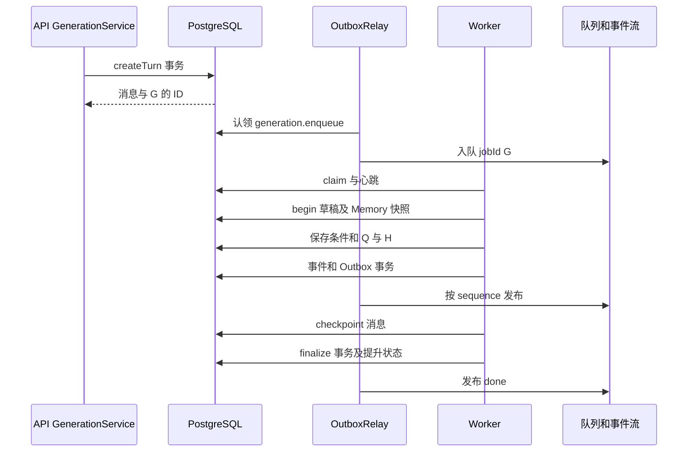

# 一次分析如何写入数据库

用途：用同一案例追踪提交、执行、查询、流式输出与终结的持久化变化，解释事务边界及异常后留下的数据。适用读者：第一次维护 Generation、状态或证据存储的开发者。字段意义见 [数据模型设计](../design/data-model.md)，本文不重复完整字段字典。

## 1. 先区分四种“已经保存”

系统没有把一整轮 LLM 和 SQL 放进一个大事务，而是逐步保存可恢复的事实：

1. **请求已受理**：消息、generation、Turn 与入队 Outbox 已提交，Worker 可能还没启动。
2. **过程已持久化**：事件、消息 checkpoint、草稿或 Artifact 已各自提交，generation 仍在 running。
3. **执行已成功提交**：generation completed，与正式分析状态、最终消息、Turn 和 done 事件在同一事务完成。
4. **结果已送到浏览器**：Relay 投 Redis、API 经 SSE 输出，前端再消费；这晚于数据库事实提交，网络断开不撤销数据库结果。

因此，页面显示过数据不等于整轮 completed；查询成功也不等于正式状态已经改变。正式 Memory 的独立保存另有边界，见 [Memory 指南](memory.md)。

## 2. 本文案例与追踪对象

以下是**教学案例，不是实际查询结果**：用户 U 在会话 C、源 D 问“按已确认的成交额口径，分析最近七天每天的趋势，展示表格与折线图”。假定该会话已有正式分析状态 revision 7、同一任务 T，已选择 Memory M v2，目录里存在可访问的业务表。

为便于阅读，C/G/T/M/Q/H 是本文使用的 ID 简写。真实代码中的会话、generation、task、Memory 和 Artifact ID 使用 UUID，源和用户使用整数。下面 JSON 只展示必要字段，省略项不能据此认为不存在。

| 简写 | 对应对象 | 预期关系 |
| --- | --- | --- |
| G | 本次 generation | request_message_id 指用户消息，response_message_id 指 assistant 消息 |
| T | 分析 state.taskId | 可与上一成功轮相同，不是 G |
| Q | Query Artifact | generation_id=G、analysis_context.state.taskId=T |
| H | Chart Artifact | generation_id=G、query_artifact_id=Q |

本例选择一个可能的工具顺序帮助理解写入，真实 Agent 还可能先读目录、补充 Schema、重写 SQL 或澄清问题，不是固定工作流。



## 3. createTurn：原子建立请求、消息和入队意图

入口：[API GenerationService.createTurn](../../apps/api/src/chat/generation.service.ts)。它先取得用户和会话 advisory transaction lock，再检查幂等键、会话归属、同会话活动任务及用户并发数。锁不跨越事务存活，也不持续到 Agent 执行结束。

本次请求在**同一个数据库事务**完成：

| 表 | 提交后的变化 |
| --- | --- |
| `message` | 新建 user 原文消息；新建 assistant 占位消息，其 content 空、blocks 和 llm_messages 为空数组 |
| `generation` | 新建 G，pending、last_sequence=0、writer_token=NULL；记录请求幂等信息、源 D、提交时间锚点和各策略标签 |
| `conversation_turn` | 新 pending Turn，sequence 为该会话最大值+1，关联 G 和两消息 |
| `outbox_event` | 新 generation.enqueue，aggregate_id=G，payload 只需版本和 generationId |
| `conversation` | 更新默认源、updated_at，标题仍为“新对话”时取问题摘要 |

其中任一步失败，以上创建整体回滚。API 返回 ID 意味着数据库提交完成，不要求 Redis 入队已完成；Redis 暂时不可用时，Outbox 可以稍后重试。

同幂等键及相同 request_hash 再请求，直接返回原四个 ID；不同摘要拒绝。第二次新问题使用新键但会话已有活动 G，则返回会话执行冲突，而不是追加另一组消息。

## 4. Outbox 入队与 claim：从“有人要做”到“由这个 Worker 做”

[OutboxRelayService.dispatch](../../apps/api/src/chat/outbox-relay.service.ts)认领待投递 Outbox，设置 locked_at/lock_token，投递 BullMQ 时使用 jobId=G。成功标 published_at，失败释放锁并延后重试。队列只携带 generationId，Worker 从数据库读取完整身份。

[Worker GenerationService.claim](../../apps/worker/src/chat/generation.service.ts)有条件地把 pending 且无 writer 的 G 改成 starting，生成 writer token W，并设置 heartbeat/started_at；随后插入 generation_attempt、再改 running。

这三步**不是一个事务**。如果进程在 starting 后、attempt 前崩溃，不存在“自动回滚成 pending”；失联监测会根据 heartbeat 终结。重复消费队列时，只有成功 claim 的执行者进入分析，其他执行者读到活动/终态就退出。

心跳续期与内容持久化无关。之后的草稿、Artifact、checkpoint 和事件写入检查 W 和 starting/running；请求取消、终结或所有权丢失会使这些写入失败。持有本地对象 G 并不能证明仍有写权限。

## 5. begin：继承已提交状态，冻结本轮知识

入口：[AnalysisRuntimeAdapter.run](../../apps/worker/src/analysis/analysis-runtime-adapter.ts)和[AnalysisStateRepository.begin](../../apps/worker/src/analysis/analysis-state.repository.ts)。Adapter 先检查源访问、处理明确 Memory 指令，再读取 active 正式 Memory 快照并 begin。普通趋势分析不会因为一次提问自动创建长期 Memory。

本例正式状态仍为 revision 7。begin 在 generation 行锁及 writer 检查后，创建：

| 草稿字段 | 本例值 | 解释 |
| --- | --- | --- |
| `generation_id / conversation_id` | G / C | 本轮工作区归属 |
| `base_revision` | 7 | 将来提交必须仍基于正式版 7 |
| `revision / state.revision` | 8 | 草稿起始版本；不是正式版已变 8 |
| `state.taskId / datasourceId` | T / D | 同源可继承任务；换源会新建任务状态 |
| `memories` | 启动时 active 记忆的完整版本集合 | 其中包含 M v2；后续管理页写 M v3 不修改此数组 |
| `context_reports` | `[]` | 随模型请求逐次追加 |

继承的 memoryRefs 若在新快照找不到同 ID 同版本，begin 会移除引用、清空旧假设并追加重新选择提示。它不会偷偷把 M v2 的引用升级成 v3。

同 G 已有草稿时 begin 返回旧草稿及旧 Memory 快照，不重新读取为另一版工作区。

## 6. 条件修改与查询：正式状态未动，证据先落盘

模型读取需要的 Schema 与 Memory 后独立调用 update_analysis_state。下面教学输入包含 required 的 expectedRevision、patch、reason，省略可选 mode 及未改变的状态字段：

```json
{
  "expectedRevision": 8,
  "patch": {
    "question": "分析最近七个完整自然日每天的成交额趋势，展示表格和折线图",
    "timeRange": {
      "start": "2026-10-07T00:00:00+08:00",
      "endExclusive": "2026-10-14T00:00:00+08:00",
      "timezone": "Asia/Shanghai"
    },
    "grain": "每天",
    "freshness": "current_generation"
  },
  "reason": "本次需要查询最近七个完整自然日"
}
```

[patchAnalysisState](../../apps/worker/src/analysis/analysis-state.ts)校验并规范化时间、字段、记忆版本，得到 revision 9；[analysisTools](../../apps/worker/src/analysis/analysis-tools.ts)先 save，成功后才替换内存 session.state 并设置 prepared。save 按旧 revision=8 条件更新草稿。这时正式 analysis_state 仍是 7。

随后 execute_sql_query 经过只读 SQL 执行与结果处理，在[ArtifactRepository.createQueryArtifact](../../apps/worker/src/chat/artifact.repository.ts)独立事务中检查 W、保存 Q。Q 包含原/实际 SQL、列类型、完整已保存行、质量信息和**查询当时 revision 9 的条件及选中 M v2 正文**。数据内容 hash 与权限指纹分别记录不同事实。

程序没有把 timeRange 编译成 WHERE，开发者还需核对 executed_sql 是否满足约定。查询计划和 state 保存正确，也不能弥补模型漏写时间筛选。

display_query_table 发送 Q 引用，不新建“表格结果表”。generate_chart 检查 Q 的适用性和质量后，另保存 H，其字段映射引用 Q。详细执行和限行场景见 [SQL 与证据指南](sql-and-artifacts.md)。

## 7. 事件与 checkpoint：相邻发生，但不是同一件事

Adapter 收到输出时更新内存 blocks，并交给 emitter。text_chunk 被合并为 text 展示块，analysis_activity 按活动 ID 更新；数据查询时未显式 display 的 table 事件被 Adapter 过滤，避免每次查询都强制显示表格。

每个持久事件由 [enqueueGenerationEvent](../../packages/database/src/generation-events.ts)在**一个事务**内完成：

1. generation.last_sequence 加 1，例如从 10 到 11。
2. 插入 generation_event，sequence=11，payload 为该事件及身份信息。
3. 插入 generation.event Outbox，保留同 eventId 和 sequence。

事件记录成功但 Relay 失败，不会丢掉事实；补洞 API 能从 PostgreSQL 找到 sequence 11。浏览器 SSE streamId 是另一种 Redis 游标，不能将数据库 sequence 11 用作用户事件流 cursor。

[checkpointMessage](../../apps/worker/src/chat/generation.service.ts)则是独立条件更新：把内存 blocks 和 turnMessages 写到 assistant message，不写 content、不写 Turn.final_answer、不提升 analysis_state。因此中途恢复可能看到表格/活动，但正文 content 仍为空。

教学展示块节选，不是完整 SSE payload：

```json
[
  { "type": "text", "content": "以下按每天统计趋势。" },
  { "type": "table", "display": true, "queryArtifactId": "教学引用Q" },
  {
    "type": "chart",
    "chartArtifactId": "教学引用H",
    "queryArtifactId": "教学引用Q",
    "chartData": {
      "chartType": "line",
      "title": "教学成交额趋势",
      "xAxis": ["2026-10-07", "2026-10-08"],
      "series": [{ "name": "成交额", "data": [120, 160] }]
    }
  }
]
```

示例图表数值同样为构造数据。实际历史恢复使用 chartData，不是只凭 chartArtifactId 重新读取独立图表接口；保存时不能丢掉它。Artifact、generation_event 和 checkpoint 不互为备份：Artifact 是数据，事件是有序过程，checkpoint 是恢复页面用的当前快照。修改持久化时应同时考虑快照模式与事件模式，而不是只看前端实时路径。

## 8. outcome 与 finalize：只有最后一步提升正式状态

Agent 返回 outcome 后，Adapter 再保存草稿 finalState：本例 revision 10，status=complete；仅当 outcome.missingItems 非空时用它替换 openQuestions，否则保留原 session.openQuestions，因此 complete 不自动清空先前问题。随后发送含 snapshot/state/选中 Memory/outcome 的空正文 text 分析块，并 checkpoint。最终 revision 不必等于 Query 的 revision 9；条件不变时两者可以正常关联。

[ChatService.runGeneration](../../apps/worker/src/chat/chat.service.ts)保存 metrics，drain 确保缓冲事件写完，再调用 finalize。成功终结的**同一事务**包括：

| 表/步骤 | 本例变化 |
| --- | --- |
| `generation` | W 和活动状态匹配后改 completed，设置 completed_at，writer_token=NULL |
| `analysis_state` | promoteAnalysisDraft 锁草稿/会话/正式状态，确认正式 revision 仍为 7，再更新为草稿 revision 10 与完整 state |
| `message` | 写最终 blocks/llm_messages，content 提取所有 text 块正文 |
| `conversation_turn` | 改 completed，final_answer 保存同一正文，completed_at 设置 |
| `generation_attempt` | 本次未完成 attempt 改 completed，设置完成时间 |
| 事件/Outbox | 保存 done，并推进 last_sequence，等待 Relay 投递 |

Q/H 在前面已经独立提交，finalize 不重新保存其数据；草稿提升后也不删除 draft。因此既有运行快照和证据仍可供诊断。

## 9. 失败、取消、冲突与删除分别留下什么

| 场景 | 数据与前端结果 |
| --- | --- |
| SQL 可纠正错误 | 工具返回 retryable 错误，由模型修正；无有效 Q，generation 可继续。语法错误不必等于全轮 failed |
| 查询后全局超时/执行失败 | 已提交 Q、草稿及事件保留；正常失败 finalize 保存部分 blocks/协议，message.content 和 Turn.final_answer 不作为成功正文保存；正式状态仍为 7 |
| 用户取消的正常路径 | API 先 cancel_requested，轮询触发中止后 finalize cancelled；completed 不允许覆盖 cancel_requested。部分过程可保留，正式状态不提升；独立直存 Memory 不撤销。取消竞争窗口也可能先报写入权丢失而以 failed 终结，见 [Generation 生命周期指南](generation-lifecycle.md) |
| 正式状态版本已不是 7 | promoteAnalysisDraft 抛 ANALYSIS_STATE_CONFLICT，completed 事务整体回滚；ChatService 再尝试 failed finalize，提示重新分析，不能只修正 base_revision 强行覆盖 |
| Worker 中途崩溃 | 有运行中的Worker监测器时，failStale 根据 heartbeat/排队时间终结 generation/Turn/attempt 并保存 done，保留之前 message checkpoint；全部Worker停止则需恢复监测，内存里尚未 checkpoint 的变化未必存在数据库 |
| Relay 不可用 | generation 可能已 completed，Outbox 未 published；事实仍存在，恢复/回放与重试投递分开排查 |
| 删除会话 | 事务内先删相应 Outbox，再删会话并级联执行/消息/证据/状态/候选；正式 Memory 留在源中。已送到 Redis 的历史事件不会因此自动逐条回收 |

失联监测不会把 draft 自动提升，也不会从 partial blocks 构造成功 final_answer；completed 与 failed 的历史资格需要明确区分。删除源、删除上传表及保留规则见 [数据模型设计](../design/data-model.md)。

## 10. 排查和修改时按什么顺序查

出现“页面像完成了但下轮没有继承”时，依次核对 generation.status、Turn.status、analysis_state.generation_id/revision、draft.base_revision，再看 finalize 是否报冲突。不要根据 message.blocks 有图就认定正式提交成功。

出现“服务端成功但页面停住”时，核对 done 的 generation_event、Outbox published_at/last_error、Redis 和前端 sequence；出现“刷新后少了一段过程”时，看该段是否进入 checkpoint 以及 history 是 events 还是 snapshot。

| 修改目标 | 必须一起阅读的入口 |
| --- | --- |
| 新增请求字段/重试语义 | [API createTurn](../../apps/api/src/chat/generation.service.ts)与[聊天提交](../../apps/api/src/chat/chat.controller.ts)；幂等摘要、源选择、队列身份不能各自漂移 |
| 改写入权或终态 | [Worker GenerationService](../../apps/worker/src/chat/generation.service.ts)、[ChatService](../../apps/worker/src/chat/chat.service.ts)、[AnalysisStateRepository](../../apps/worker/src/analysis/analysis-state.repository.ts)、[ArtifactRepository](../../apps/worker/src/chat/artifact.repository.ts)；所有写路径都要考虑取消竞争 |
| 改状态提交 | [promoteAnalysisDraft](../../packages/database/src/analysis-state-schema.ts)和[Adapter](../../apps/worker/src/analysis/analysis-runtime-adapter.ts)；正式版本、草稿版本、JSON 版本和 completed 事务一起检查 |
| 改事件结构/回放 | [enqueueGenerationEvent](../../packages/database/src/generation-events.ts)、[Relay](../../apps/api/src/chat/outbox-relay.service.ts)、[history/stream](../../apps/api/src/chat/generation.service.ts)及[前端恢复](frontend-streaming.md) |
| 改历史结果保留/删除 | [ConversationService.remove](../../apps/api/src/conversation/conversation.service.ts)、DDL 外键与[Memory 来源保留](memory.md)；Outbox 无外键需要显式处理 |

本文只说明当前已确认调用和事务边界。生产表实际规模、保留期限、备份恢复策略和数据库隔离部署仍需部署资料确认，不能从当前 DDL 推断。
