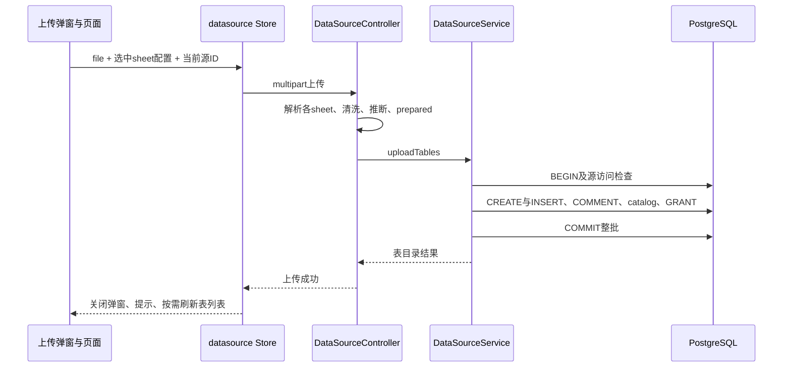
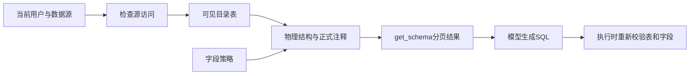

# 数据源导入、Schema 与字段语义指南

用途：理解数据准备怎样变成 Agent 可查询的结构，并能修改上传、权限、字段注释和推荐功能。适用读者：数据源、API、Agent 和前端开发者。

本文按“创建工作空间 → 上传文件 → 发现结构 → 审核语义 → 分析使用”展开。示例文件、用户、ID 和表名均为教学构造，未向数据库执行，不代表项目存在这些业务数据。实体字段含义统一查 [数据模型](../design/data-model.md)，SQL 执行细节查 [查询指南](sql-and-artifacts.md)。

## 1. 先理解三个不同对象

用户看到“渠道经营数据”，并不意味着服务端建立了新的 PostgreSQL 连接。当前 `DataSourceService.create` 接收名称和说明，创建逻辑源及所有者许可；`DatabaseClient` 查询使用同一个连接目标。

| 对象 | 教学示例 | 作用及来源 |
| --- | --- | --- |
| 逻辑数据源 | data_source.id=7、name=渠道经营数据 | 权限和知识的归属边界；一个源可以登记多张表 |
| 目录记录 | datasource_table_catalog.id=31、datasource_id=7 | 将物理表登记到源；包含展示名、来源类型、Agent 可见性 |
| 物理表 | public.ut_示例时间_示例后缀 | 实际保存导入行；程序生成真实表名，用户名称只作标签 |

需要判断“这个表能不能分析”时，至少检查源访问、目录可见性、真实字段政策和查询账号授权；仅看到表已上传或数据源卡片不能证明全部条件满足。

代码入口：[DataSourceService.create/uploadTable](../../apps/api/src/datasource/datasource.service.ts)、[DatabaseClient/getAgentVisibleCatalogTables](../../packages/database/src/index.ts)。

## 2. 一次文件上传从前端到数据库

### 2.1 前端准备的是文件与选项

[UploadTableModal.handleFileSelection](../../apps/web/src/components/datasource/UploadTableModal.vue) 对 Excel 在浏览器读取 sheet 名，形成可勾选项；CSV 默认用去扩展名的文件名作 displayName。浏览器这一步主要服务选择界面，服务端仍重新读取文件。

`handleSubmit` 发出的 selected 配置去掉界面字段 `selected`。`DataSourceView.handleUpload` 使用当前 `uploadTargetDs.id` 作为实际源 ID，不使用弹窗事件中占位的 `_id`；[datasource Store.uploadTable](../../apps/web/src/stores/datasource.ts) 构造 multipart：

```text
POST /api/datasources/7/tables
file: 用户选中的 CSV / XLS / XLSX 二进制
 tableConfigs: JSON 字符串，内容如下
```

```json
[
  { "sheetName": "渠道日报", "displayName": "每日渠道经营" }
]
```

CSV 不需要 sheetName；Excel 可同时选择多张 sheet。这个 JSON 是 FormData 中的字符串，不能改成普通 JSON body 后仍假定接口兼容。

### 2.2 Controller 将文件转换为待入库对象

[DataSourceController.uploadTable](../../apps/api/src/datasource/datasource.controller.ts) 先校验文件、配置、扩展名；上传拦截器限制 20 MiB，每个 CSV 或选中 sheet 限制 50,000 行。Excel 使用 `sheet_to_json({defval:null,raw:true})`，CSV 用 csv-parser；无数据、不存在的 sheet 或无效配置直接失败。

教学原始行：

```json
[
  { "渠道": " 搜索 ", "成交额(元)": "1,234.50", "成交日期": "2026-10-01" },
  { "渠道": "社交", "成交额(元)": " ", "成交日期": "2026-10-02" }
]
```

转换过程：

| 阶段 | 上述输入如何变化 | 当前机制及边界 |
| --- | --- | --- |
| normalizeValue | 搜索两侧空格去掉；金额千分位去逗号；空金额变 null | 清除零宽/BOM/NBSP，非有限 number 变 null；不做业务编码解释 |
| 列名清洗 | 成交额(元)变为成交额_元；保留原名 | 非字母/数字/下划线/中文字符替换并修剪；尝试重复后缀 |
| inferMysqlType | 成交额_元判 DOUBLE；渠道和成交日期判 TEXT | 全部非空值都数字才用数字类型；日期字符串没有自动日期识别 |
| coerce | 金额字符串转 number 1234.5，空金额保持 null | 不能据此推断金额精度、缺失含义或单位；这些需业务语义 |
| Service pgType | DOUBLE映射 NUMERIC，TEXT保持 TEXT | 名称中的 Mysql 是遗留命名；落地数据库仍是 PostgreSQL |

传给 Service 的对象可以理解为下面的节选：

```json
{
  "displayName": "每日渠道经营",
  "columns": [
    { "name": "渠道", "originalName": "渠道", "type": "TEXT" },
    { "name": "成交额_元", "originalName": "成交额(元)", "type": "DOUBLE" },
    { "name": "成交日期", "originalName": "成交日期", "type": "TEXT" }
  ],
  "rows": [
    { "渠道": "搜索", "成交额_元": 1234.5, "成交日期": "2026-10-01" },
    { "渠道": "社交", "成交额_元": null, "成交日期": "2026-10-02" }
  ]
}
```

同一文件中的每个选中 sheet 都先完成解析并放入 `prepared`。当前按首行 keys 决定列集，不建立通用数据清洗/关系推断流程；文本类型也不表示模型知道业务定义。

### 2.3 Service 在一个事务里落地整批表

[DataSourceService.uploadTables/uploadTable](../../apps/api/src/datasource/datasource.service.ts) 对所有 prepared 表共用一个事务，依次执行：

1. 锁数据源并验证公共/所有者/共享许可，拒绝 `is_local=1` 默认源上传。
2. 检查 displayName 1–100 字符、列有效、列名允许的字符和首字符。
3. 为每张表生成 `ut_${Date.now()}_${random}`，CREATE TABLE；批量 INSERT 使用参数占位，批大小约为 `60000 / 列数`。
4. COMMENT ON TABLE 保存展示名，列 COMMENT 初始保存 originalName。
5. 注册 `schema_name=public`、`source_type=uploaded`、`is_agent_visible=true` 的目录记录。
6. 配置了 Agent DB 角色时，向其 GRANT SELECT。

任何一步失败都回滚整批物理表、行、注释和目录，包括多 sheet 中前面已经执行的表。Controller 解析阶段失败则尚未进入这段数据库事务。成功后只返回表目录描述，不返回全部上传行。



事务后清 API 本进程 Schema Prompt 缓存，Controller 异步失效/重建服务端推荐。推荐生成失败不撤销已经提交的表。

### 2.4 哪些导入限制会影响后续分析

- 数字编码如“00123”可能按数字列导入，前导零不作为业务标识保留；日期字符串和 Excel raw 序列也没有完整日期推断。
- 清洗后缀尚不能保证最终全局唯一，例如不同原表头 a!、a?、a_1 经过清洗可依次变成 a、a_1、a_1；没有显式 PostgreSQL 63 字节列名长度规范。实际输入是首行对象的keys，不能用重复原键作为并存表头例子。不能把“已清洗”写成“任意表头都可导入”。
- 金额字段由原表头提供单位线索，但导入过程没有确认指标口径；空值也不被自动解释成零。
- 当前 `DataSourceView.handleUpload` 未显式调用浏览器的 `invalidateSuggestions`，因此服务端推荐失效与浏览器已有按源缓存不是同一动作。

这些是代码边界及可能影响；本次没有运行文件导入复现。调整类型推断要先明确兼容旧数据和列名/原注释展示，不能只改数据库 pgType 映射。

## 3. 授权、目录和字段政策如何协作

### 3.1 数据源访问与管理权限

`assertDatasourceAccess` 和 `DataSourceService.canAccess` 的访问规则是：公共（created_by 为 null）或所有者或存在 datasource_permission。目录中 `created_by` 表示上传人，和源所有者可能不同。

| 操作 | 当前权限与额外条件 |
| --- | --- |
| 源列表、表列表、分析、结构读取 | 当前用户能访问源；Agent查询还受目录与列策略 |
| 上传表 | 可访问且非默认源；共享用户可成为表上传人 |
| 改源名称/说明、授权/撤销、看许可名单 | 源所有者 |
| 删除源 | 源所有者且非默认源 |
| 删除表 | 可访问、source_type=uploaded，且为源所有者或上传人 |
| 查看/生成/写入列注释 | 可访问，且为源所有者或该表上传人 |
| 写正式Memory或确认候选 | 源所有者，详见[Memory指南](memory.md) |

例如 A 创建源并授权 B，B 可以上传表并审核自己上传表的注释，但不能据此修改源共享许可或正式 Memory。此区别由 Service 权限检查决定，前端隐藏按钮只是界面引导。

依据：[DataSourceService](../../apps/api/src/datasource/datasource.service.ts)、[共享访问函数](../../packages/database/src/schema-access.ts)、[SchemaEnrichmentService.table](../../apps/api/src/datasource/schema-enrichment.service.ts)。

### 3.2 Agent 发现的是可见目录及真实列

`getAgentVisibleCatalogTables` 只选当前 schema、当前源、is_agent_visible=true 的登记表。源管理 `listTables` 则列该源目录记录，因此管理员看到的表列表和 Agent 目录可以不同。

Worker `SchemaService.getSchemaCatalogSummary` 提供 name/displayName/description；模型用 list_schema 发现相关表，再 get_schema 读详细字段，每页20项。`getStructuredSchema` 查询 information_schema、obj_description、col_description，并按列策略隐藏 deny 字段。

API structured Schema 响应数组中的单表条目（字段节选）：

```json
{
  "tableName": "ut_教学示例",
  "display_name": "每日渠道经营",
  "isUploaded": true,
  "sourceType": "uploaded",
  "fields": [
    { "name": "成交额_元", "type": "numeric", "comment": "成交额(元)", "masked": false }
  ]
}
```

Worker `getSchemaDetail` 转成 datasourceId/schema/table/columns 的模型工具形式，列说明用 description；当前没有把 structured Schema 的 masked 标记传入 detail。查询执行时仍读取实际 mask/deny 政策，Schema 描述不能扩大可执行权限。



get_schema 读结构不会改变权限；目前也不返回自动外键图、完整枚举、数据统计画像或指标表达式。`loadedSchema` hash记录已读取结构，但执行器不要求每个 SQL 字段都已经通过 get_schema 分页加载。

代码：[API SchemaService](../../apps/api/src/database/schema.service.ts)、[Worker SchemaService](../../apps/worker/src/database/schema.service.ts)、[analysisTools](../../apps/worker/src/analysis/analysis-tools.ts)。

### 3.3 两个 SchemaService 的缓存区别

API `getDatabaseSchemaPrompt` 有60秒缓存，按源/用户索引并比较当前列政策fingerprint；`getStructuredSchema` 本身不使用这份Prompt缓存。Worker 按需读取结构，没有同一缓存。

上传/删除/注释保存清当前 API 进程的源Prompt缓存；多API实例之间没有共享失效消息。不能把API的整库Schema Prompt机制当作Worker主分析的输入路径：Worker主分析由目录与分页工具按需加载。

## 4. 字段注释增强：建议如何成为正式语义

### 4.1 建议阶段只读数据库

`TableListModal` 打开 [SchemaEnrichmentModal](../../apps/web/src/components/datasource/SchemaEnrichmentModal.vue)，inspect读取正式列，默认勾选最多100个空注释列；用户可以选择其他字段后请求 suggestions。

Service 验证1–100个不重复字段，确认源所有者/上传人，再读取结构、原注释和最多五行样本。样本只取agent_access不是mask/deny的选中列；数据库LEFT限制单元长度，原注释给模型时最多200字符并标commentTruncated。模型调用在读取事务之后进行，期间不长期持锁。

教学建议节选：

```json
{
  "column": "成交额_元",
  "suggestedComment": "成交金额，原字段标注单位为元。",
  "basis": "original_metadata",
  "needsVerification": ["是否扣除退款，尚需确认"]
}
```

`basis`是原元数据或有限样本依据标签，不证明业务口径完整；needsVerification明确模型不能确定的事项。此示例有单位来自原表头的依据，不用金额大小推断单位。

`parseEnrichments`验证选中列、字段集合、枚举、重复/长度；模型可返回空建议。生成结束再次inspect检查当前权限。直到用户保存，正式COMMENT不变。

### 4.2 审核与保存阶段使用原注释检查冲突

用户编辑建议并勾选要写入的项，前端changes包括：

```json
{
  "changes": [
    {
      "column": "成交额_元",
      "originalComment": "成交额(元)",
      "comment": "成交金额，单位元；退款口径请按已确认业务定义使用。"
    }
  ]
}
```

服务端先验证 comment 为非空、最多1000字符；当前接口不支持通过空字符串清除注释。保存事务重新核对权限，锁物理表，检查字段仍存在且正式注释等于originalComment，再用PostgreSQLformat `%I/%L`安全生成并执行COMMENT。不能使用普通bind占位替代COMMENT的标识符/字面量处理。

若别人已经改为另一条正式注释，返回409且整批不写。前端 `refreshOriginals` 重新读取正式值、保留你的建议文本、取消所有勾选，让用户重新核对；不会自动把冲突视为可覆盖。成功后删除服务端推荐缓存、清API源Prompt缓存；前端移除已保存建议并invalidateSuggestions。

这条链路没有独立“注释建议表”：建议保留在弹窗状态，正式内容进入PostgreSQL列注释。保存也不会自动新建Memory或重算历史分析。

## 5. 推荐、删除与后续分析

首页推荐由 `SuggestionService.getSuggestions` 取得真实structured Schema，按language/schemaHash/Prompt version及hash组成key，存入 `datasource_suggestions.questions`。给模型按整张表选取约16,000字符，超大表可跳过；没有可用结构可返回空列表，不填固定业务示例。当前这段调用不读取正式Memory全文或数据行。回答后的推荐是Worker另一条辅助调用，详见[Agent指南](agent-loop.md)。

浏览器额外按源缓存推荐，不能仅凭服务器已失效推断旧浏览器缓存已刷新。需要改推荐内容，分别检查数据依赖、服务端key与客户端失效点。

删除上传表在同事务DROP物理表、删除列策略/目录/源推荐；源删除仅DROP其uploaded物理表再删源，其他关联按外键处理。源表变化可能使已有证据失去访问指纹匹配，但指纹并不是完整物理Schema版本。删除/权限变化对历史消息和Artifact的不同影响见[问题记录](risks-and-open-questions.md)。

## 6. 修改入口与推演问题

| 想修改的行为 | 首要入口 | 必须同时核对 |
| --- | --- | --- |
| 文件/多sheet选择 | UploadTableModal、DataSourceView | multipart字段、服务端重新解析、整批事务 |
| 列名或类型推断 | Controller清洗函数、Service pgType | 前导零/日期/精度/标识符碰撞、旧表语义 |
| 源共享或上传权限 | DataSourceService、schema-access | Worker实时检查、Memory不同写权限、前端按钮 |
| 新Schema元数据 | 两个SchemaService、contracts | get_schema分页、Prompt预算、字段政策、UI结构 |
| 注释建议或审核 | ENRICHMENT_PROMPT、SchemaEnrichmentService、Modal | 样本限制、原注释冲突、批次原子、建议不自动生效 |
| 推荐 | SuggestionService、datasource Store | Schema hash/语言/Prompt缓存key，各变更失效点 |

阅读后应能推演：多sheet中一张失败为什么整批不留表；B上传表后为何能改注释但不能确认Memory；最后一页Schema为何不证明模型此前已加载全部字段；注释建议返回后别人修改正式注释时为什么必须刷新审核。这些问题的答案对应上述真实分支，本次没有执行交互验收。
