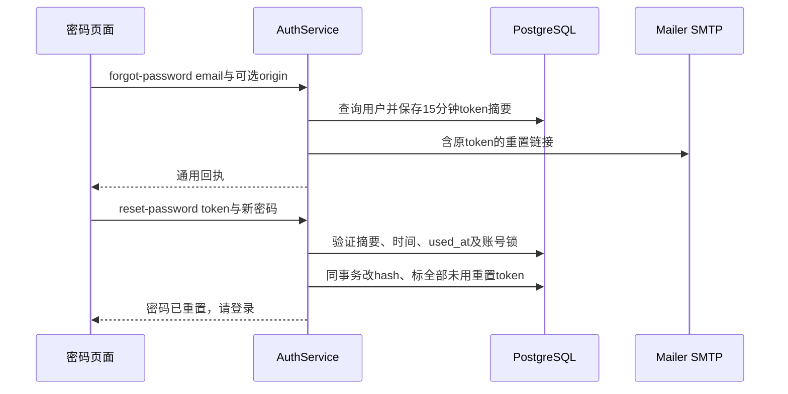

# 开发环境、代码导航与基础业务

用途：让首次接手的开发者知道需要启动什么、怎样从用户操作找到代码，以及账号/会话基础行为如何运行。适用读者：所有开发者与AI Coding。

本篇给出开发者可手动执行的命令及其作用；本次只生成文档，没有安装依赖、启动服务、建库、迁移或运行交互测试。模型、SQL、状态和持久化机制请沿本文导航继续阅读，不需要从目录第一项逐文件读起。

## 1. 为什么开发时需要三个应用

用户打开Web不代表分析已经能执行。API负责创建任务，Worker才消费队列并执行Agent；二者都依赖平台PostgreSQL，队列/实时消息依赖Redis。

| 运行单元 | 启动入口 | 负责的行为 | 未准备好时通常影响 |
| --- | --- | --- | --- |
| Web | apps/web/src/main.ts | 路由、Store、输入/过程/结果界面 | 用户无法使用页面 |
| API | apps/api/src/main.ts | /api账号、数据源、会话、任务/SSE、Outbox Relay | 请求失败、队列未投递、无实时流 |
| Worker | apps/worker/src/main.ts | BullMQ、Agent、SQL、状态/证据、过期监测 | 创建成功后可能一直pending；需有运行中的Worker监测器才能按排队超时终结，全部Worker停机时不会自行收敛 |
| PostgreSQL | DB配置 | 账号/任务/状态/Memory以及目录中的物理分析表 | API/Worker启动Schema检查或业务读写失败 |
| Redis | REDIS_URL | BullMQ、容量租约、用户事件流 | 排队、获取执行容量或订阅失败 |
| 模型服务 | LlmClient | 主Agent和辅助推荐/注释建议 | 分析或对应辅助功能失败 |
| SMTP | MailerService | 发送重置链接 | 账号仍可登录，找回密码操作失败 |

Worker health端口默认3001，`/health`只说明该HTTP进程能应答，不验证全部依赖。API3000、Web5173是代码默认；精确变量见[配置参考](../reference/configuration.md)。

## 2. 本地准备与启动步骤

### 2.1 环境与依赖

Dockerfile和根README采用Node22、pnpm9.15.9；根package.json没有engines/packageManager强制本地版本。工作区由[pnpm-workspace](../../pnpm-workspace.yaml)管理apps/packages，允许相应native依赖构建。

先准备明确的开发PostgreSQL和Redis，按实际地址填写根`.env`，至少核对DB/Redis/模型/JWT；已有文件保留，不在文档中复制真实密钥。`loadWorkspaceEnv`按进程cwd找`.env`或`../../.env`，只加载第一个存在文件。Compose宿主机映射为PG15432、Redis16379，容器内部仍是postgres:5432/redis:6379。

开发者可运行：

```bash
pnpm install --frozen-lockfile
pnpm --filter @gist/config --filter @gist/contracts --filter @gist/database --filter @gist/llm build
```

共享包的main/types指向dist。构建共享包使应用能解析当前版本依赖；仅改packages/src但继续使用旧dist，可能出现“代码看起来已改、运行行为仍旧”的现象。apps的Nest watch不能被当成整个共享工作区自动构建承诺。

### 2.2 初始化应当针对确认可写的开发库

```bash
pnpm init-db
```

[init-db.ts](../../apps/api/scripts/init-db.ts)连接管理库检查/创建DB，再applyCurrentSchema，插默认逻辑源，配置可选Agent只读角色和目录表SELECT授权。它会修改数据库及角色，不能用于只读检查；不会导入演示事实表。默认本地源禁止上传，首次使用应创建自己的源再上传文件。

应用启动的 `DatabaseClient.connect` 只SELECT1并校验当前列类型，不自动初始化或迁移。若启动报Schema不匹配，先确认连的是哪个环境、当前部署需要什么升级，不能直接对未知库执行重置。

### 2.3 启动与修改后的快速检查

```bash
pnpm dev
```

根dev使用concurrently同时启动api/worker/web；也可分别dev:api、dev:worker、dev:web。Vite固定将`/api`代理到localhost3000，改SERVER_PORT要同时考虑代理目标。

| 命令 | 作用及写入范围 |
| --- | --- |
| pnpm typecheck | 各包快速类型检查；Web vue-tsc -b可能写tsbuildinfo |
| pnpm build | 构建应用/共享包，写产物，不是运行验收 |
| python3 docs/reference/generate.py --check | 只读检查API和DDL参考与源码一致 |
| python3 docs/verify.py | 只读检查文档路径/导航/图结构等 |
| pnpm migrate:database | 显式结构升级，包含删除退役表；需先核对目标和脚本 |
| pnpm migrate:memory-provenance | 来源/候选关联约束升级，仍是数据库写操作 |

当前根package.json没有通用test/lint命令；不要依据已删除脚本写“全套回归已通过”。默认开发验证用类型检查/构建和必要的最小相关测试；浏览器E2E、完整回归、真实外部服务需要用户明确要求。本轮docs变化只执行文档检查。

## 3. 按用户功能找到真实入口

| 用户遇到的问题或要改的能力 | 第一层入口 | 下一层与指南 |
| --- | --- | --- |
| 登录、改昵称、改密、找回 | 页面、auth Store、MainLayout | Auth/User Controller与Service，见本文第4节 |
| 新对话、历史与删除 | ChatView/ChatSidebar、chat Store | ConversationService，见本文第5节 |
| 提问/取消/重试 | ChatInput、chat.sendMessage | API ChatService/GenerationService → [生命周期](generation-lifecycle.md) |
| 模型选工具与回答 | Worker ChatService → Adapter | AnalysisAgent → [Agent Loop](agent-loop.md) |
| 上下文、追问、最新数据 | Adapter.prepareContext、analysisTools | AnalysisState/ContextAssembler → [状态](context-and-state.md) |
| SQL、安全、证据、图表 | SQL/Chart Tool、ArtifactRepository | [查询指南](sql-and-artifacts.md) |
| 上传、共享、字段注释 | DataSourceView与datasource Store | DataSource/Schema服务 → [数据源指南](datasource-and-schema.md) |
| 长期口径和候选 | MemoriesView、AnalysisBlock | MemoryRepository → [Memory指南](memory.md) |
| 文字流/过程/结果/断线 | chat Store、ChatMessageItem | [前端流式指南](frontend-streaming.md) |
| 某字段什么时候被写 | 平台DDL和仓库方法 | [数据模型](../design/data-model.md) → [持久化指南](database-persistence.md) |

API和Worker都有同名ChatService/GenerationService/SchemaService，搜索时带apps路径。API分析ChatService主要创建任务；Worker同名服务执行壳层。主Prompt在worker/analysis，而不是把所有模型行为都放在packages/llm/prompts。

## 4. 账号：客户端登录状态怎样变成服务端身份

### 4.1 注册与登录

公共接口注册/登录经auth Store fetch `/api/auth/...`，Controller检查基本输入，AuthService规范邮箱为lowercase/trim；密码用bcrypt cost10。登录查hash并compare，返回user和JWT，不返回密码hash。

JWT的sub是用户ID，credentialsVersion是当前password_hash的SHA-256摘要；有效期由AuthModule配置七天。前端存localStorage.auth_token、Store.user，普通`apiFetch`和SSE fetch加Bearer头。router.requiresAuth检查浏览器状态并按需POSTauth/me，但最终身份由全局JwtAuthGuard和JwtStrategy决定。

因此“浏览器还存token”和“当前请求被服务端允许”是两件事。JwtStrategy验证签名/有效期后查用户及credentialsVersion；用户删去或密码变更后拒绝旧凭证。Memory、源授权和Artifact仍需在这个身份上进一步检查业务权限。

代码：[auth Store](../../apps/web/src/stores/auth.ts)、[router](../../apps/web/src/router/index.ts)、[AuthService](../../apps/api/src/auth/auth.service.ts)、[JwtStrategy](../../apps/api/src/auth/jwt.strategy.ts)、[JwtAuthGuard](../../apps/api/src/auth/jwt-auth.guard.ts)。

### 4.2 改密码为何使旧token失效

MainLayout收集currentPassword/password/确认密码；auth.updatePassword发PUTusers/password。UserService事务锁账号，验证currentPassword，将新bcrypt hash写app_user，并标该用户未用重置token为已用。前端成功后logout，清auth/chat/datasource状态并跳登录。

另一个标签页即使还留旧JWT，下次鉴权也因credentialsVersion不匹配而失败；代码没有JWT黑名单或Refresh Token流程。不能把前端logout当成旧凭证失效的唯一机制。

### 4.3 找回密码的分步边界



数据库password_reset_token.token存摘要，邮件URL携原随机token；同一个helper名credentialsVersion还用于token摘要，不表示重置凭证是JWT。未知邮箱正常返回，不暴露是否注册；SMTP未配置/发信失败可能报错，不能声称任何情况下都已送达。

保存token和SMTP发送不是同事务。发信失败不自动删除已保存token；模型分析也不参与找回流程。生产APP_ORIGIN要求显式配置，开发回退origin/localhost；有效期十五分钟，成功重置后全用户未用链接都失效。关键字段见[数据模型](../design/data-model.md)。

## 5. 会话：从空会话到可恢复历史

创建`POST /api/conversations`只写空conversation，不调用模型或创建generation。ChatView.onMounted先fetchConversations，再根据路由convId选择；首次提问可以由chat.sendMessage自动创建会话。

首问标题按前30字符生成，createTurn在默认标题时替换；这里没有标题总结模型。会话updated_at随新任务创建更新，列表按该字段排序；前端实时事件还更新本地updatedAt，两者不要当同一计时信号。

`getMessages`检查会话userId，读取message并LEFT JOINresponse generation带id/status/sequence；按时间、user优先、ID排序，避免同一事务两条消息时间相同时顺序不稳。前端用blocks恢复结果、用generation字段恢复运行状态。后续模型历史用completed Turn的question/final_answer，详见[状态指南](context-and-state.md)。

删除入口是chat.deleteConversation：本地已知活动任务先请求cancel，再DELETEconversations。服务端ConversationService.remove取得会话advisory lock及generation行锁，删相关Outbox再删conversation；消息/任务/证据/候选按外键删除，正式Memory保留来源UUID。没有等待每个Worker确认取消后再删除的完整前端握手机制，写入方靠行存在及writer条件退出。

代码：[ChatView](../../apps/web/src/views/ChatView.vue)、[ConversationService](../../apps/api/src/conversation/conversation.service.ts)、[chat Store](../../apps/web/src/stores/chat.ts)。

## 6. 修改一个功能应该同时看什么

以“增加一个分析工具”为例：从Worker注册列表和Tool接口开始，定义模型输入、运行parseArguments与确定性execute，接入必要的writer/signal/权限边界；再看其结果如何变成模型tool消息、活动事件、blocks和历史恢复。需要持久字段时核对contracts与DDL/迁移。Prompt允许模型调用工具不等于注册与执行已完成，后端事件生成也不等于前端已支持显示。

以“改一个业务口径”为例：区分永久Memory、本轮temporaryNotes和物理列comment，再检查本轮快照/memoryRefs/conditionSignature及实际SQL。仅改知识文本不会重算旧结果，也不会自动变成SQL过滤。

每次变更的最小核对范围应与调用链一致，避免只检查修改文件本身。细化入口见各领域指南，排查方法见[问题记录](risks-and-open-questions.md)。

## 7. 迁移和部署边界

[migrate-database.mjs](../../scripts/migrate-database.mjs)现有默认分支删除退役business_definition表并调整指定列；`--reset-analysis`会丢弃会话/分析/Memory等表数据。`CREATE IF NOT EXISTS`不自动升级旧表的所有列、索引和约束；字段类型检查不证明全Schema正确。执行前需明确目标库与当前版本，本次未执行。

[Compose](../../docker-compose.yml)定义PG/Redis/API/Worker/Web及工具profile；[Nginx](../../apps/web/nginx.conf)支持SPA路由回退和关闭SSE buffering。[部署workflow](../../.github/workflows/deploy.yml)在main push或手动触发，先typecheck/build，再SSH串行部署：拉代码、构镜像、准备依赖、停应用、PG备份、显式迁移/初始化、启动应用。

流程中有备份步骤不能证明备份已做恢复演练；本次也没有触发CI/部署。实际凭据、线上角色/目录、配置、性能和模型表现仍属于运行待确认范围。
