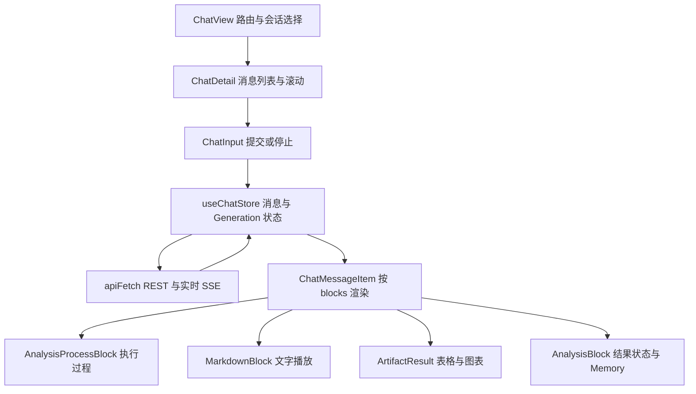
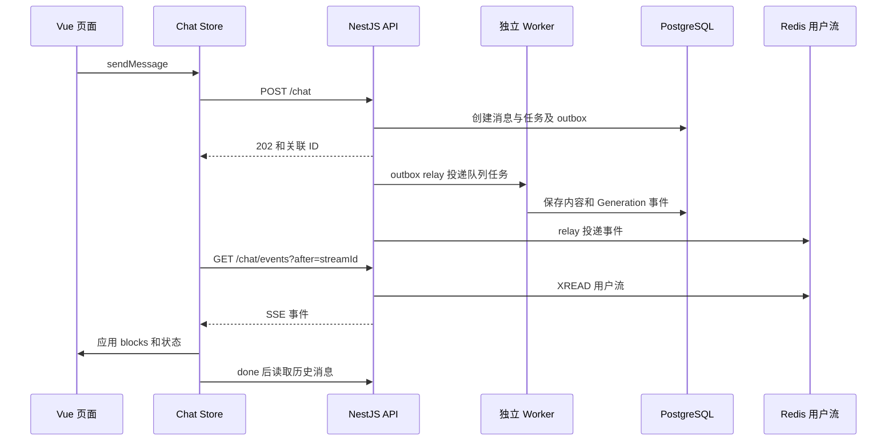

# 前端流式协作、历史恢复与结果展示指南

用途：让开发者能够推演一次消息发送后，页面状态、实时事件、历史消息及结果组件如何协同变化，并定位该改哪一层。适用读者：Vue、API、流式协议和结果展示开发者。

本文以当前源码为依据，协议示例的 ID、正文和事件序号均为**教学构造，未运行交互测试**。请求路径写的是 apiFetch 接收的相对路径，浏览器实际请求带 `/api` 前缀。服务端执行与持久化机制见[Generation 生命周期](generation-lifecycle.md)，SQL 和结果边界见[SQL 与 Artifact 指南](sql-and-artifacts.md)。

## 1. 页面、Store 与消息对象怎样分工



| 层 | 真实入口 | 维护的内容 |
| --- | --- | --- |
| 页面 | [ChatView.syncConversation](../../apps/web/src/views/ChatView.vue) | 路由 convId 与当前会话一致；首次挂载读取会话列表 |
| 会话视图 | [ChatDetail](../../apps/web/src/components/ChatDetail.vue) | 消息列表、最后一条 assistant 的 streaming 提示、滚动跟随、数据源抽屉入口 |
| 输入 | [ChatInput.handleSubmit](../../apps/web/src/components/ChatInput.vue) | 本地文本、自动高度、禁止当前会话重复发送、停止按钮和深度思考开关 |
| 状态 | [useChatStore](../../apps/web/src/stores/chat.ts) | conversations、activeConversationId、generations、connectionState；发送/取消/重试、事件应用和恢复 |
| 网络 | [apiFetch](../../apps/web/src/api.ts) | `/api` 前缀、Bearer token、JSON Content-Type；401 清 token 并跳转登录 |
| 展示 | [ChatMessageItem](../../apps/web/src/components/ChatMessageItem.vue) | 过程与正文分开、终态提示、重试按钮、文字播放协调和推荐问题展示条件 |

每条 ChatMessage 有 content 和 blocks。用户消息显示 content；assistant 主要按 blocks 渲染。SSE 的 text_chunk 会合并到文字 block，前端没有同时把每个 chunk 拼到 message.content。最终 content 与历史 blocks 从消息 API 恢复。修改正文展示时，要核对 blocks 的实时聚合和历史载荷两条路径。

GenerationState 按 generationId 保存：id、conversationId、messageId、status 和 sequence。`activeGeneration` 是当前会话中 pending/starting/running/cancel_requested 的任务；`isLoading` 由它推导。连接断开状态与任务运行状态独立：disconnected 不代表任务 failed。

## 2. 首次发送：从输入文本到 assistant 占位

假定用户没有活动会话，输入“查看本次数据的趋势”。按 `handleSubmit → sendMessage` 推演：

| 时刻 | Store 与页面的实际变化 | 服务端行为或返回 |
| --- | --- | --- |
| 点击发送 | 输入暂时清空并重置高度；正在运行的本会话不允许再提交 | 尚未创建 Generation |
| 创建会话 | POST /conversations，列表前置新会话并设为 active | 返回会话 ID |
| 乐观用户消息 | 用随机 localUserId 添加用户消息；首条消息以正文前 30 字符更新本地标题，路由切到 /chat/:id | 正式消息尚未确认 |
| 提交分析 | POST /chat，携带新的 Idempotency-Key 及 message/conversationId/datasourceId/reasoningEnabled | API 验证会话和数据源访问，事务创建消息、Generation、Turn 和入队 outbox |
| 收到 202 | 将本地用户 ID 替换为 userMessageId；补充 responseMessageId 的空 assistant；登记 pending、sequence=0 | 返回四个标识，不在这个响应中传分析正文 |
| 收到首个事件 | 按 generationId 与 conversationId/messageId 定位消息；非终态事件通常将本地状态设为 running | Worker 执行经事件投递到用户 SSE |
| 收到 done | 更新任务终态，触发 fetchMessages 对齐已持久化结果 | 数据库历史提供最终 content/blocks 和 Generation 状态 |

构造的请求最小形态：

```json
{
  "message":"查看本次数据的趋势",
  "conversationId":"11111111-1111-4111-8111-111111111111",
  "datasourceId":7,
  "reasoningEnabled":false
}
```

构造的 202 返回形态：

```json
{
  "generationId":"22222222-2222-4222-8222-222222222222",
  "conversationId":"11111111-1111-4111-8111-111111111111",
  "userMessageId":"33333333-3333-4333-8333-333333333333",
  "responseMessageId":"44444444-4444-4444-8444-444444444444"
}
```

[ChatController.chat](../../apps/api/src/chat/chat.controller.ts) 接收请求，[ChatService.startChat](../../apps/api/src/chat/chat.service.ts) 验证归属并计算 requestHash，再调用 Generation 创建逻辑。完整事务见生命周期指南。

失败路径也影响页面：409/CONVERSATION_GENERATION_ACTIVE 提示本会话已有任务，429 提示任务过多；sendMessage catch 删除尚未确认的乐观用户消息并 Toast。ChatInput 仅在用户没有重新输入、且会话仍合适时恢复原文本，避免把失败文本覆盖到另一会话。每次 sendMessage 都生成新的幂等键；当前前端没有自动重发同键的请求队列。首次 createConversation 在 sendMessage 的请求 catch 之前执行，因此不能笼统宣称所有创建失败都会走同一套回滚分支。

## 3. REST 提交与 SSE 返回为什么分开



图中省略了心跳、writer 检查和批量缓冲，API 到 Worker 的任务投递实际经 Redis/BullMQ 队列，不是直接 RPC。这里强调三种不同通道：POST 创建任务，SSE 传递实时变化，历史 API 恢复持久化事实。SSE 网络连接关闭只停止订阅，Worker 任务继续；用户点停止必须发 cancel API。

[enqueueGenerationEvent](../../packages/database/src/generation-events.ts) 在事务中分配逻辑 sequence 并保存 generation_event 与 outbox；[OutboxRelayService.publishEvent](../../apps/api/src/chat/outbox-relay.service.ts) 投递到 Redis；[GenerationService.stream](../../apps/api/src/chat/generation.service.ts) 再给事件加实际用户流 streamId 并写 SSE 帧。数据库 payload 中的 streamId 是占位的 0-0，历史恢复不能拿它作为用户流最新位置。

## 4. 协议中两种游标必须分清

| 字段 | 意义 | 谁生成、谁保存 | 用途 |
| --- | --- | --- | --- |
| streamId | Redis 用户流的投递位置，例如 1790812800123-0 | Redis 生成；Store 当前连接变量与 sessionStorage 保存 | GET /chat/events?after=… 从用户流继续读，包含多个会话的事件 |
| sequence | 一个 Generation 内的逻辑事件编号，例如 11 | 数据库事件写入递增，Store GenerationState 和 generation.last_sequence 保存 | 判断重复/缺口，GET /chat/generations/:id/events?after_sequence=… 回读 |
| eventId | 事件身份 | 事件持久化时生成，relay 用于投递去重 | 当前前端 applyEvent 主要按 sequence 去重，不能描述为前端按 eventId 去重 |

同一用户流中可能交错 A 会话 sequence=8 和 B 会话 sequence=3。streamId 增长不意味着任一 Generation 的 sequence 连续，两种游标不能互相换算。

下面是构造的 text_chunk 帧；UUID 和 streamId 均不是实际运行记录：

```text
id: 1790812800123-0
event: text_chunk
data: {"type":"text_chunk","content":"我会先核对数据范围。","eventId":"55555555-5555-4555-8555-555555555555","streamId":"1790812800123-0","generationId":"22222222-2222-4222-8222-222222222222","conversationId":"11111111-1111-4111-8111-111111111111","messageId":"44444444-4444-4444-8444-444444444444","sequence":11}

```

前端使用 fetch + ReadableStream，而不是 EventSource，以便通过 apiFetch 带 Bearer。TextDecoder 处理字节流，buffer 按空行切帧，未完整帧留到下一次读取；找到 data 行后解析 JSON。心跳是注释帧 `: heartbeat`，没有 data 行，因此被忽略。当前代码使用 JSON 内的 streamId 和 type；并不依赖浏览器 EventSource 的 Last-Event-ID 自动机制。

## 5. 首次连接、断线和 sequence 补洞

### 5.1 首次连接先对齐活动任务

fetchConversations 调用 startRealtime，`realtimeStarted` 避免重复开流。它先从 sessionStorage 取上次 cursor，再 GET /chat/sync，最多携带 100 个 known_generation_ids：

1. 对 activeGenerations 注册状态，sequence 初始为 0，并逐个 resync 回读。
2. 对 reconciledGenerations 更新本地状态和 last_sequence。
3. 用 sync.eventCursor 作为开始读用户流的位置。

服务端 sync 同时返回消息 content/blocks，但当前 reconciled 分支只应用任务状态与序号；不要把它描述为已完整恢复终态正文。活动 resync 则通过 events 或 snapshot 尝试恢复内容，随后接续 SSE。

sessionStorage key 带当前 token 的末 16 字符，避免直接把所有登录态共享一个固定游标。这里只是客户端游标隔离方式，服务端身份检查仍由 Bearer 与 userId 决定。

### 5.2 按 sequence 应用和去重

`applyEvent` 的核心规则：

- `event.sequence <= current.sequence`：返回 duplicate，不再追加 block。
- `event.sequence > current.sequence + 1`：返回 gap，暂不应用该事件。
- 正好下一条：先更新序号/状态，再按会话和消息 ID 聚合 block。

未知 Generation 的连续首帧可以创建本地状态；会话已在列表但消息不存在时，正常 applyEvent 会创建 assistant。会话不在当前 conversations 时，仍更新 GenerationState，但不创建对应会话和正文。切到那个会话后应依赖会话/消息加载，而不是假定所有后台会话都已经完整缓存。

### 5.3 具体推演：已收到 10，直接收到 12

假定本地 Generation 已登记，sequence=10，第 11 帧在网络中缺失，第 12 帧是一个文字增量：

1. applyEvent(12) 返回 gap；sequence 仍是 10，文字不立即追加。
2. 流循环 await resync，发送 GET /chat/generations/:id/events?after_sequence=10。
3. 服务端从 PostgreSQL 查询序号大于 10 的持久事件，判断它们是否从 11 开始连续。
4. 回读成功后，再尝试应用原先挂起的第 12 帧。

假定服务端回复以下教学结构，其中 events 里的对象包含实际事件的完整身份字段，此处只展示关键字段：

```json
{
  "mode":"events",
  "events":[
    {"type":"text_chunk","sequence":11,"content":"范围已核对。"},
    {"type":"text_chunk","sequence":12,"content":"接下来读取趋势。"}
  ],
  "lastSequence":12
}
```

Store 依次 applyEvent(11) 和 applyEvent(12)，序号到 12，正文只追加一次。然后原 SSE 第 12 帧再次进入 applyEvent，因为已经小于等于 12，返回 duplicate。循环最后仍将用户流 cursor 更新为这条实时帧的实际 streamId，历史 events 中的占位 streamId 不参与这个更新。

### 5.4 同一个缺口怎样转为 snapshot

[GenerationService.history](../../apps/api/src/chat/generation.service.ts) 不仅检查数组是否连续，还检查终态任务是否包含 done。缺事件、序号不连续，或者终态事件无法完整回放时，改用消息快照：

```json
{
  "mode":"snapshot",
  "snapshot":{
    "content":"构造的已保存回答",
    "blocks":[{"type":"text","content":"构造的已保存回答"}],
    "sequence":12,
    "status":"running",
    "error":null,
    "errorCode":null
  }
}
```

Store 设置 current.sequence=12、status=running；如果本地消息已经存在，就用快照 content/blocks 替换它。随后原 SSE 第 12 帧成为 duplicate。若快照 sequence=11，则回放结束后第 12 帧正常追加；若快照更晚，例如 15，则第 12 帧也被丢弃，因为状态已经包含到 15。

需要留意真实边界：当前 snapshot 分支不会主动创建缺失消息，不触发 done 对应的 fetchMessages，也不消费 snapshot.error/errorCode。它以现有消息对象为恢复目标。若第一个实时帧已经大于 1，而 Store 又没有该 Generation 的状态，resync 因没有 current 而直接返回；不能宣称这种情况会自动完整补洞。这些是当前实现行为，相关风险见[问题与待确认事项](risks-and-open-questions.md)。

### 5.5 断线重连保持什么

网络失败后 connectionState 变为 disconnected；循环从 1 秒起退避，最多 15 秒，再用当前 streamId 请求用户流。重连不会自动再次调用 sync；只有收到逻辑缺口时才回读单任务历史。如果 Redis 流已过期、任务已经结束又没有新事件，不能只凭“重新连上 SSE”保证旧正文已经补齐；历史会话加载仍是重要恢复入口。

当前 cursor 会在处理实时帧后写 sessionStorage。resync 后第二次 applyEvent 的返回值没有再循环检查；因此不要把这一段包装成无限可靠的缺口修复器。修改恢复逻辑时，需要同时核对已知任务注册、快照更新、终态补正文以及游标推进条件。

## 6. 事件怎样变成 blocks 和用户可见内容

事件不是直接交给组件绘制。先由 Store 聚合成 MessageBlock，再由 ChatMessageItem 筛选并传给组件。类型定义分别位于 [Worker SSEEvent](../../apps/worker/src/chat/tools/base-tool.ts) 与[前端 types](../../apps/web/src/types/index.ts)。

| 实时事件 | applyBlock 的具体变化 | 最终展示与注意点 |
| --- | --- | --- |
| text_chunk | 最后一块是非 analysis 的 text 时拼接，否则追加 text | MarkdownBlock；正文顺序取决于块顺序，不拼进 message.content |
| text，带 analysis | 保留 analysis.state/snapshot/outcome/memories | AnalysisBlock 显示业务完成状态、采用口径和候选卡片 |
| analysis_activity | 按 activity.id 替换已有过程块或追加 | AnalysisProcessBlock；同一动作从 running 更新为 completed/warning，后者携带问题说明 |
| analysis_activity_remove | 按 activityId 删除过程块 | 参数修正或工具失败时可能移除临时动作 |
| log_update/remove | 逆序寻找标题匹配且 content 以“正在”开头的 log，修改或移除 | 通常归入过程展示；已完成 log 不被这条规则随意覆盖 |
| table，display=true | 保存 Artifact 引用与标题 | ArtifactResult 按需读取表格；不是 SSE 直接传全部明细 |
| chart | 填充最后一个缺 chartData 的占位图，或新增图块 | 保存 chartData/queryArtifactId/chartArtifactId；数值随 blocks 恢复 |
| memory_notice | 保存 memoryNotice | MemoryNoticeBlock 显示真实保存结果及保存时版本 |
| suggestions | 保存 version/items | 最新消息、任务 completed、文字播放结束时才显示 |
| reasoning_chunk | 忽略，不存展示块 | 原始模型 reasoning 不是产品展示协议 |
| done | applyEvent 更新任务状态，applyBlock 不追加正文 | 触发历史读取，输入解除运行状态 |
| error | applyEvent 依据内容设置 failed/cancelled，再追加错误块 | 终态提示与错误 Markdown 一起提供反馈 |

共享协议还保留 thinking、chart_loading 等兼容类型，Worker 类型另含 sql_chunk；这不代表当前主 Agent 会输出每一种。增加事件之前先确认活跃 producer，避免仅看到 union 类型就把它写成产品能力。

`ChatMessageItem.visibleBlocks` 隐藏 thinking/reasoning；有分析流程时，将非 display 的 activity/log/sql/table 留在过程区，不在正文重复展示。已查询结果可从过程详情的“查看结果/SQL”打开，不必自动出现在最终回答中。AnalysisProcessBlock 还会合并同一模型轮内相邻已完成的目录/Memory/Schema 读取活动，并隐藏 inspect_evidence 类型，避免把协议事件数量当成 UI 展示步骤数量。

## 7. done、历史恢复与失败/取消是怎样协作的

done 的构造业务载荷可以是 `{"type":"done","status":"completed"}`，再加上事件身份和序号。completed 是运行终态；分析 outcome 的 complete/partial/awaiting_clarification/unable_to_complete 是业务结果，两者不是同一个状态。一个需要澄清的正常回答也可以拥有 completed Generation。

done 后 `fetchMessages(conversationId)` 读取[ConversationService.getMessages](../../apps/api/src/conversation/conversation.service.ts)。API 将 message 与关联 Generation 连接，带回 generation_id/status/sequence。Store 先登记这些状态，再按 ID 对齐消息：

1. 仍活动的消息尽量保留现有对象，避免历史接口覆盖实时播放。
2. 已有消息的 blocks 相同则直接保留对象。
3. blocks 不同则 Object.assign 更新已有对象的 content/blocks，而不是总重新创建。
4. 首次加载历史消息才创建新的对象；新挂载的 Markdown 通常立即显示历史内容。

这样可以让 done 与最后一个文字事件在同一次网络读取中到达时，文本播放仍能排空。不能为了“任务完成”直接把整个 assistant 替换成一个全新历史组件，否则可能重置动画或阅读位置。

取消：点击停止 → POST /chat/generations/:id/cancel → 请求成功后本地 status=cancel_requested → 输入按钮显示“正在停止”并禁用 → 等服务端终态事件。它不是直接把任务标 completed，也不是仅 abort SSE。状态为 cancelled 时，ChatMessageItem 明确提示已有内容不代表完整结论。

重试：failed/cancelled 显示“重试原问题”，`retryGeneration` 调 POST /chat/generations/:id/retry，登记新的 generationId/responseMessageId，sequence=0，并刷新历史。服务端读取原请求再创建新分析；不是沿着旧 writer 的执行栈继续，也不是重放旧 blocks。clear 用于清除登录后的本地状态、abort 实时 fetch，不能当作服务端任务取消接口。

多会话：一条用户 SSE 为所有会话服务，事件按 conversationId/messageId 路由；切换会话不关闭后台任务。发送禁用由 activeGeneration 决定，因此其他会话是否能启动由 API 的并发约束共同控制，而不是全页面只有一个全局 loading 布尔值。

## 8. 表格、图表与“查看依据”的恢复路径不同

### 8.1 显式表格是 Artifact 引用

[ArtifactResult](../../apps/web/src/components/blocks/ArtifactResult.vue) 对拥有 queryArtifactId 和 conversationId 的 table 选择 AnalysisArtifactTable；旧的内联表数据可走 TableBlock 兼容分支。

[AnalysisArtifactTable.load](../../apps/web/src/components/blocks/AnalysisArtifactTable.vue) 先读元数据，再读 limit=100 的第一页。加载更多使用 nextCursor 拼接行；cursor 是结果数组偏移量，不是对源数据库开启游标。props 改变时递增 revision，使旧请求结果不能写到新 Artifact；error、loading 和 nextCursor 由组件独立管理。limited 和 quality.warnings 直接呈现在表头附近。

过程区的结果查看也按需调用 Artifact API，可逐页读取最多已存储的行。最终显式表格与过程区引用相同证据，但拥有各自的加载与展开状态。

### 8.2 图表数值随 message.blocks 保存

chart 事件包含 chartData；Store 保存它，历史消息 API 再返回同样的 blocks。Chart Artifact 记录来源与字段映射，当前没有公开的独立 Chart Artifact 读取 API。恢复图表时，前端直接用已有 chartData 构造 ECharts option，而不是重新执行 SQL。

[ChartBlock.buildOption / renderChart](../../apps/web/src/components/blocks/ChartBlock.vue) 处理图种和样式；监听根节点主题 class、ResizeObserver 和窗口 resize；卸载时 dispose。后端 rendered 只表示已产出载荷，不证明浏览器成功绘图。如果流中已经收到正确 series 却没有图，应继续检查组件挂载、容器尺寸和 option 映射。

AnalysisBlock 还保留 outcome 引用 chartArtifactId 时，通过同消息 reportCharts 找对应 chartData 的兼容渲染分支；这种载荷恢复需要同时保留引用和 chart 块。当前 Adapter 发送的 analysis.outcome.blocks 固定为空，正文与图表直接保留在外层 message.blocks，避免重复渲染。当前主链路也不能只持久化图表 ID 而丢掉 chartData。

### 8.3 依据面板与权限复核

[QueryEvidence.load](../../apps/web/src/components/blocks/QueryEvidence.vue) 重新读取 Artifact 元数据，展示 purpose、查询时间、粒度、timeRange/comparisonRange、filters、临时口径、查询时 Memory 版本和 quality，优先显示 executedSql，并在不同于 originalSql 时允许展开原文。

[AnalysisArtifactController.read](../../apps/api/src/analysis-artifact/analysis-artifact.module.ts) 每次复核用户、会话、数据源权限、有效期和访问指纹；变化可返回 409 要求重查。因此历史表格按需读取和依据面板不是单纯的本地缓存展示。

会话历史 API 的 getMessages 则核对会话归属后直接返回持久化 blocks，没有逐块重新验证 Artifact 字段策略。由历史 blocks 直接恢复的 chartData，和通过 Artifact API 读取的表格/依据，权限复核路径不同。开发者不能假定撤销列权限后历史图表就会自动消失；这是当前需要明确理解的维护边界。

## 9. Memory 卡片为什么不是最终结论的一部分

有 analysis 的 text 块交给 [AnalysisBlock](../../apps/web/src/components/blocks/AnalysisBlock.vue)。它区分三类内容：

- outcome 的正文、完成状态和 missingItems：本轮回答及缺失条件。
- usedMemories：按 state.memoryRefs 过滤查询采用的 Memory 版本，显示的是本轮快照，后续编辑不修改历史内容。
- candidates 与保存回执：读取现有待确认候选、供用户编辑确认，保存成功后显示未来分析可采用；不自动重算刚才的结果。

followup 区等 `!isStreaming` 且同消息文字播放结束后显示。候选只在当前用户是数据源创建者时加载，并按 sourceMessageId 等于 analysis.snapshot.requestMessageId 过滤，避免一条历史回答显示另一轮候选。

“编辑并保存”交给[MemoryCandidateCard](../../apps/web/src/components/MemoryCandidateCard.vue)和[MemoryEditor.save](../../apps/web/src/components/MemoryEditor.vue)，携带候选版本和已有 Memory 版本，后端冲突返回 409。放弃保存会关闭候选，不撤销此前查询。“仅本次使用”先拒绝长期候选，再通过 chat.sendMessage 提交临时约定；要求当前没有活动分析且用户回到该会话。这是一次后续分析请求，不是直接修改历史答案。

[MemoryNoticeBlock](../../apps/web/src/components/blocks/MemoryNoticeBlock.vue) 则展示实际保存动作的回执及保存时版本，并链接到 Memory 管理页。长期记忆机制和保存边界详见[Memory 指南](memory.md)。

## 10. 文字播放与滚动是独立于 SSE 的状态

### 10.1 received 不等于 displayed

`applyBlock` 收到 text/text_chunk 会暂设 message.animateText=true，并在 nextTick 后清除。即使最后正文和 done 同批到达，MarkdownBlock 仍有机会按流式内容开始播放。

[MarkdownBlock.advance](../../apps/web/src/components/blocks/MarkdownBlock.vue) 每 16 毫秒按剩余长度追加 1 至 6 个 Unicode 字符；displayedContent 与 props.content 分离。任务 done 之后，只要播放仍有积压，timer 继续排空，不随 Generation 状态立刻清空。历史首次挂载且不在播放时直接显示全文。MarkdownIt 设置 html=false，数据中的 HTML 不作为原始 HTML 开启执行。

ChatMessageItem 提供 [textPlaybackKey](../../apps/web/src/utils/text-playback.ts)，同一消息的 Markdown 渲染器按注册顺序推进，统计 playingTextCount。AnalysisBlock 的报告块还通过正在播放的标记暂时隐藏后续块，followup 和 suggestions 等待文字完成。因此“任务已完成但推荐问题还没出现”可能是播放状态，而不是没有收到 done。

### 10.2 自动跟随尊重阅读位置

ChatDetail 使用 following、userIntent、panelOpen 及 ResizeObserver 控制滚动。位于底部时内容增长会跟随；滚轮、触摸、方向键或拖滚动条先暂停跟随；回到底部或点击“回到最新”再恢复。底部判定在[isAtBottom / shouldPauseFollowing](../../apps/web/src/utils/scroll-follow.ts)中，容忍约 4 像素误差，并区分内容布局改变与用户向上移动。

ArtifactResult 打开“放大”或“依据”弹窗时保存 message-list 的 scrollTop，发送 result-panel-open 暂停跟随；关闭时恢复位置并发送 result-panel-close。修改图表高度、Markdown 播放或结果弹窗时，都可能影响 ResizeObserver 和滚动意图。排查阅读跳动应同时看这些入口，不能只检查 SSE 的到达速度。

## 11. 修改功能时怎样保证实时与历史一致

| 修改目标 | 需要同时检查的代码与行为 |
| --- | --- |
| 新增事件或字段 | Worker SSEEvent、前端 types、Adapter.emit 持久聚合、Store.applyBlock、组件 props、Generation 事件和历史 blocks；只修改实时渲染不够 |
| 修改过程展示 | activity.id 更新规则、活动完成/失败字段、AnalysisProcessBlock 合并/过滤规则；保留真实 SQL 和结果入口 |
| 修改消息恢复 | startRealtime 注册任务、sync 对齐、history 的连续/终态判断、resync events/snapshot、fetchMessages 对象复用 |
| 修改任务状态 UI | activeGeneration 的状态集合、done/error 映射、cancel_requested 按钮、failed/cancelled 重试；业务 outcome 单独显示 |
| 修改表格分页 | Artifact API 参数限制、组件 cursor/revision/错误重试；翻页不能重查或悄悄改变证据范围 |
| 修改图表恢复或权限 | chartData 的事件与历史保存、outcome 的图表 ID、字段指纹复核路径；历史 blocks 不会自动走新 Artifact 读取 |
| 修改打字效果或滚动 | animateText、Markdown timer、textPlaybackKey、showFollowup 和 suggestions 条件、ResizeObserver 与弹窗位置恢复 |

排查时按“是否已发送请求 → Generation 是否已登记 → streamId 是否前进 → sequence 是否连续 → blocks 是否正确聚合 → visibleBlocks 是否过滤 → 组件是否加载/播放”的顺序缩小范围，避免把正文隐藏、播放等待和网络断线混为一个问题。

本次仅静态核对源码与构造协议推演，未运行浏览器 E2E、真实服务集成或交互验收。
