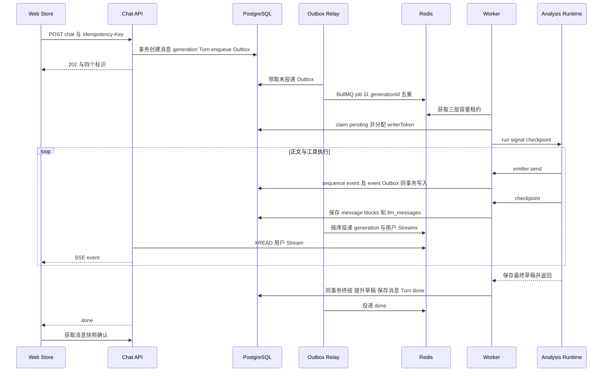
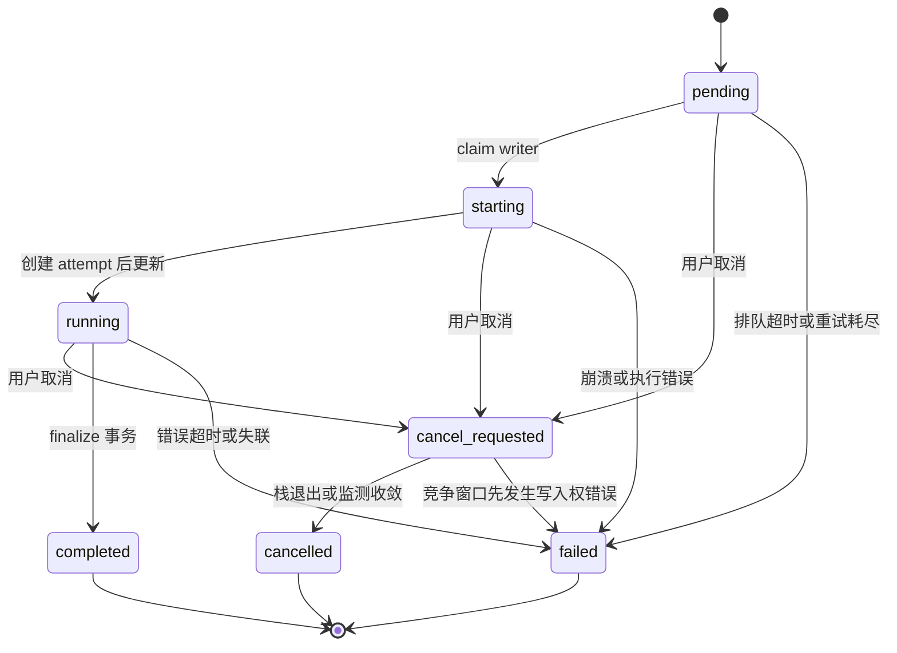

# Generation 生命周期、队列与事件持久化

用途：追踪一次用户提问如何从 HTTP 请求变成可恢复的回答，并解释取消、重复投递、失联和状态提交。适用读者：API、Worker、会话和可靠性维护者。模型内部行动顺序见 [Agent Loop](agent-loop.md)，浏览器补事件及渲染见 [前端流式指南](frontend-streaming.md)。

本文的 ID、时刻和故障案例为教学构造，描述当前代码路径，不代表真实运行记录。默认时长来自安全配置与源码；实际部署可能覆盖可配置值。

## 1. generation、Turn、message 和 attempt 为什么分开

一次聊天请求同时产生几个实体：

| 实体/标识 | 代表什么 | 主要消费者 |
| --- | --- | --- |
| `conversationId` | 用户的一个会话 | 会话页面、权限检查、分析状态归属 |
| `userMessageId` / `request_message_id` | 本轮原始问题 | Worker 领取后读问题；retry 重新读取原问题 |
| `responseMessageId` / `response_message_id` | 回答占位及最终展示快照 | SSE 定位消息、页面恢复、最终正文和 blocks |
| `generationId` | 一次异步执行，独立于浏览器连接 | 队列 job ID、writer、事件 sequence、取消和历史补洞 |
| `conversation_turn` | 会话内一轮问答及 sequence | 最近成功历史、`final_answer`、本轮是否可进入分析上下文 |
| `generation_attempt` | Worker 成功 claim 后的一次执行记录 | writer、首个 delta、终态和排障 |

模型调用多轮不会创建多个 generation。BullMQ 的 `attempts=5` 是队列重试预算，也不等于五条 `generation_attempt`：只有数据库 claim 成功才新增 attempt。当前没有从某个工具 checkpoint 接着执行的 durable resume。

## 2. 从提交到回答的完整链路

关键边界是：**HTTP 202 表示创建成功，finish_analysis 表示分析协议结束，PostgreSQL finalize 提交才表示执行终结，SSE done 是终结结果的投递**。这几个时间点不能互相替代。

## 3. API 事务如何防止重复问题和并发覆盖

[API ChatService.startChat](../../apps/api/src/chat/chat.service.ts) 先确认会话归属、显式选择的数据源权限，再计算请求 hash。hash 包括 `conversationId`、`message`、显式 `datasourceId` 和 `reasoningEnabled`，不是只按问题文字去重。

[API GenerationService.createTurn](../../apps/api/src/chat/generation.service.ts) 在一个数据库事务中依次做：

1. 获取用户 advisory lock，再获取会话 advisory lock，序列化并发提交。
2. 查 `(user_id, idempotency_key)`。同 key、同 hash 返回原有四个 ID；同 key、不同 hash 拒绝，避免把别的问题关联到旧任务。
3. 锁会话行，检查会话内是否已有 `pending / starting / running / cancel_requested`。有活动任务返回 409；取消请求未终结仍占槽位。
4. 检查用户活动 generation 数量，超过 API 用户上限返回 429，默认上限 5。
5. 从数据库时钟取得 `context_upper_bound`；记录最近 completed 回答的 `parent_message_id`，保存本轮源、模型与运行策略版本。
6. 创建 user 消息和空 assistant 消息，创建 pending generation 和 pending Turn，写 `generation.enqueue` Outbox，更新会话标题/数据源。
7. 提交后返回 ID。以上任一步失败，事务内新记录一起回滚。

教学例子：浏览器第一次 POST 已被服务器接收但响应在网络中丢失。用同一个幂等 key 重发同一请求会拿回原 generation，不会插入第二组消息；若重发时换了问题却沿用 key，服务器拒绝。显式“再分析一次”或失败后的 retry 则应创建新 generation。

`effectiveDatasourceId` 会继承会话源；无显式源的请求 hash 仍记录 `null`，不是最终解析出的源。Worker 实际模型读取自己的环境配置，API 保存的是 API 进程配置的模型名。因此模型记录要与实际调用一致，需要部署保证 API/Worker 配置一致，数据库记录本身不能强制两者相同。

## 4. Outbox 与队列分别解决什么

API 不在创建事务中直接依赖 Redis 成功。`generation.enqueue` 记录与 generation 同库提交，使 Redis 暂时不可用时任务仍有可重投递的请求。

[OutboxRelayService.dispatch](../../apps/api/src/chat/outbox-relay.service.ts) 每 250ms 领取至多 20 条到期记录，使用 `FOR UPDATE SKIP LOCKED` 和 lock token；30 秒前的投递锁可回收。领取事件后：

- enqueue：BullMQ `jobId=generationId`，最多 5 次指数退避，初始 delay 500ms。
- `generation.event`：按数据库 sequence 投到 generation Stream 与用户 Stream，event ID 去重。
- 非法 payload/type：进入 dead letter。
- 一般投递异常：清锁、保存 last_error、退避重试，间隔封顶 60 秒；当前没有通用最大重试次数。

Redis 成功、数据库 `published_at` 尚未提交时进程退出，Relay 会再次投递。job ID 和事件 Lua 去重处理这一窗口，不能据此称所有跨系统行为拥有一次且仅一次语义。

## 5. Worker 的容量许可与写入权是两种保护

[ChatService.executeGeneration](../../apps/worker/src/chat/chat.service.ts) 首先读 candidate：终态或不存在直接返回；cancel_requested 尝试终结取消；只有 pending 才进入容量和 claim。

| 保护 | 机制 | 保证的范围 |
| --- | --- | --- |
| Redis 容量许可 | [GenerationReliabilityService.acquire](../../apps/worker/src/chat/generation-reliability.service.ts) 对全局、provider、用户三个 sorted set 使用 Lua；清过期租约后同时检查/占槽 | 限制实际并发资源消耗，不赋予写数据库的权利 |
| 数据库 claim | [GenerationService.claim](../../apps/worker/src/chat/generation.service.ts) 仅更新 `pending AND writer_token IS NULL`，写 starting 与新 token | 相同任务只能有一个成功 claim 的执行者 |
| writer 检查 | `assertWritable`、草稿保存、publish、checkpoint 均检查 token 及状态 | 旧执行者、已取消或已被监测终结的进程不能继续写正常结果 |
| 心跳 | 数据库 heartbeat 和 Redis renew 同时执行 | 判断数据库执行者与容量许可是否仍有效 |

claim 成功后新增 `generation_attempt`，再将 generation 设 running。这不是一次把所有操作包起来的大事务；若进程在中间崩溃，可能暂留 starting 或缺 attempt，由失联监测收敛终态。

默认每 5 秒续约，租约 TTL 20 秒；任一数据库/Redis续约失败都会设置 `ownershipLost`。执行栈每 500ms 检查该标志并 abort，工具边界和发布动作也独立检查数据库 writer。代码刻意不在每个模型 token 上查询数据库。

重复 queue job 到达已 running 任务时，candidate 检查会直接返回，并不会重新跑 Agent。Worker 崩溃后也不自动从旧草稿接续；运行中的[ZombieGenerationMonitorService.checkOnce](../../apps/worker/src/chat/zombie-generation-monitor.service.ts) 使用 `leaseTtlMs * 2` 终结失联执行，默认阈值约 40 秒。pending 排队超时默认 10 分钟。监测只注册在Worker，全部Worker停止时没有进程执行回收，需其他或重新启动的Worker继续监测。

## 6. 取消、超时与竞争窗口

[API GenerationService.cancel](../../apps/api/src/chat/generation.service.ts) 只把活动任务写为 cancel_requested，并记录首次取消时刻；它不直接假定模型/SQL 已停止。Worker 的 `runGeneration` 用一个 AbortController 同时连接：

- 用户取消轮询，间隔 500ms；
- ownershipLost；
- 全局分析定时器，默认 120 秒，执行上限也是 120 秒。

LLM 和工具共享 signal；SQL 执行器尝试数据库取消。执行壳先 abort 并等待调用栈退出，再 finalize。取消到停止之间仍存在外部调用响应和排队事件窗口，不能把点击取消视为瞬间清除所有部分结果。

`finalize(completed)` 的条件明确禁止覆盖 cancel_requested。若正常完成和取消同时发生，completed 条件更新失败，执行壳再次查取消状态并改走 cancelled 终结。若 writer 已被监测器清除，旧执行者 finalize 返回 false，不能覆盖新的终态。

另有需要区分的竞争窗口。**推断，待运行验证**：取消轮询触发前，`assertWritable / checkpointMessage / publish` 已因数据库 status=cancel_requested 拒绝写入，可能先抛 `WRITER_OWNERSHIP_LOST`；[normalizeGenerationError](../../apps/worker/src/chat/generation-errors.ts) 优先保留这类错误 code，执行壳可因此走 failed。源码有 completed 与取消竞争的补偿，却未对这一先抛 writer 错误的路径做同样转换。因此排障时要同时看 `cancel_requested_at` 与 error_code，不能断言所有取消都一定记录 cancelled；两种路径都不提升草稿。

关闭页面或停止 SSE/fetch 只是停止浏览器连接；任务仍在 Worker 运行。会话删除路径会先尝试取消，再删除数据库实体；随后执行者因为行不存在或 writer 不匹配失去写入权。

教学例子的正常路径：用户已看到查询表格，随后取消。后续内容停止，前端进入取消状态，部分 blocks 可保留；本轮不进入成功历史，草稿不提交。表格已创建的 Artifact 不等于正式分析状态已提交，其后续复用还要检查来源 generation 是否成功。该行为与“模型合法返回 partial 后执行 completed”不同；上述竞争分支可能记录failed。

## 7. 同一段正文为什么有事件、blocks 和 content 三种记录

[AnalysisRuntimeAdapter](../../apps/worker/src/analysis/analysis-runtime-adapter.ts) 的 emit 一边调用 emitter，一边更新 `blocks`。`text_chunk` 合并到相邻普通 text block；同 ID 活动替换，活动移除则删除，log_update 替换进行中的 log。因此 blocks 是展示快照，不是原始事件的逐条列表。

[TextEventBuffer](../../apps/worker/src/chat/text-event-buffer.ts) 最多约 16ms 合并正文碎片，遇工具/其他事件先 flush，保持发生顺序。`GenerationService.emitter` 为每个 generation 串联 Promise 发布队列；`drain` 在结束时 flush 并等待所有已排事件，是异步发布失败的错误边界。

| 存储 | 写入时机 | 用途与边界 |
| --- | --- | --- |
| `generation_event.payload` | 每个发布事件（正文可合并） | 持久事件历史和 sequence；SSE 断连仍有依据 |
| `outbox_event` | 同一个事件事务 | 请求 Relay 送到 Redis；不是独立的新正文 |
| `message.blocks` | checkpoint 与 finalize | 页面消息快照、活动/图表/分析信息；checkpoint 间可能落后于流式事件 |
| `message.llm_messages` | checkpoint 与 finalize | assistant/tool 协议，包含模型真正的调用和反馈；不是纯展示正文 |
| `message.content` | finalize | completed 时连接普通 text blocks；中途可能仍为空，failed/cancelled 时最终置空但 blocks 可含部分文字 |
| `conversation_turn.final_answer` | completed finalize | 与最终正文同源，供后续历史上下文；可能包含过程说明，不是独立提炼的纯最终结论 |

[GenerationService.publish](../../apps/worker/src/chat/generation.service.ts) 锁 generation 并验证 writer 后调用 [enqueueGenerationEvent](../../packages/database/src/generation-events.ts)。在同事务中递增 `generation.last_sequence`，插入事件和 event Outbox。Redis 不负责当前主路径的 sequence 分配。

Relay 在同 generation 还有低序号、未投递且非死信事件时，不领取高序号事件；低序号死信被排除后可继续投递，因此逻辑序号可能有缺口。Lua 把相同 payload 写两条 Stream 并按 event ID 去重。Redis键使用用户 hash tag；流和去重键 TTL 为 24 小时，活跃写入会刷新，不是每条事件恰好保留 24 小时。源码仍有 `generation.terminal` 兼容分支，不能据其 Redis `INCR` 推断主路径仍如此分配序号。

## 8. checkpoint 不等于完成，finalize 才提交正式状态

Agent 在完整模型/工具批次后 checkpoint，适配器在 Memory 通知、最终分析元数据和推荐后也 checkpoint。`checkpointMessage` 只更新 blocks 和协议，且要求 writer 与活动状态仍匹配。

执行壳在 Runtime 返回后记录调用/SQL/token 估算指标，drain 事件，然后调用 finalize。completed 的一个事务包含：

1. 条件更新 generation 终态、完成时间和 error，清 writer token。
2. [promoteAnalysisDraft](../../packages/database/src/analysis-state-schema.ts) 锁草稿和会话，检查正式 revision 是否等于草稿 `base_revision`，提升草稿。
3. 根据普通 text blocks 提取 finalAnswer，写 `message.content / blocks / llm_messages`。
4. 更新 Turn 的 status/final_answer 及 attempt 终态。
5. 通过持久事件函数写 done 与其 Outbox。
6. 全部提交。任一步异常，前面的 completed 更新也回滚。

草稿缺失或 base 冲突时，执行壳捕获 `ANALYSIS_DRAFT_MISSING / ANALYSIS_STATE_CONFLICT`，重新按 failed 终结，用户看到“分析状态提交冲突，本轮草稿未提升”。流式文字可能已经展示，这并不等于它进入了下一轮成功历史。

分析结局和执行终态的组合必须保留：

| 分支 | generation / Turn | 分析草稿 | 用户结果 |
| --- | --- | --- | --- |
| finish complete | completed | 提升，state.status=complete | 正文/展示与完成 |
| finish partial、awaiting_clarification、unable_to_complete | completed | 提升相应业务状态 | 保留部分结果、必要问题或不能完成说明 |
| LLM/工具异常、上下文超预算、全局超时 | failed | 不提升 | 保留部分 blocks 与错误，不能作为成功历史 |
| 用户取消由 signal 处理 | cancelled | 不提升 | 取消终态，可保留部分内容；先发生 writer 错误的竞争分支可能 failed |
| 失联/排队超时 | failed 或取消后的 cancelled | 不提升 | 持久 done 告知失联或取消；可能只恢复到最近 checkpoint |

SQL 安全/访问错误若被 Loop 的专门停止分支转为 `unable_to_complete`，属于第二行；若在适配器外围直接抛出，属于执行失败路径。正式 Memory 的保存是独立知识事务，generation 失败不会自动撤销先前已经确认保存的 Memory。

## 9. 重连、重投递与 retry 如何区分

| 行为 | 是否重新调用模型 | 依据 |
| --- | --- | --- |
| SSE 断线重连 | 否 | 用户 Stream 游标接续，generation sequence 查缺口 |
| history 补洞或快照恢复 | 否 | 持久事件连续性与消息 blocks |
| BullMQ 重投已 running/终态任务 | 否 | candidate/claim 检查 |
| failed/cancelled 的 retry | 是 | 读取原始问题，再调用 startChat 创建新 generation |

API `sync` 返回用户流游标和活动/已知任务。`history` 检查数据库持久事件是否连续、终态 done 是否可见；不能完整补齐时返回消息快照。前端用户流 `streamId` 与任务 `sequence` 各有职责，具体补洞算法见 [前端流式指南](frontend-streaming.md)。

retry 拥有新的请求/响应消息、generation、时间锚点和上下文。它从上一次已提交分析状态开始重新理解原问题，不能称为“继续执行失败的 SQL 后一步”。

## 10. 修改和排障入口

| 现象/变更 | 优先检查 |
| --- | --- |
| 202 后一直排队 | generation pending；enqueue Outbox 的 `published_at / attempts / last_error / next_attempt_at / dead_lettered_at`；Relay 与 Redis可用性 |
| job 重试耗尽仍未执行 | capacity acquire、claim 前异常；`failQueued` 仅能终结尚 pending 无 writer 的任务 |
| 卡在 starting/running | writer heartbeat、Redis三层租约、失联监测阈值；不能只看 SSE 是否还有数据 |
| UI已收正文但任务 failed | finish 协议、drain错误、状态提升冲突和全局超时；核对 blocks 与持久终态 |
| 取消后出现已完成 | 先判断读取的是旧 snapshot 还是最终 generation，检查条件 finalize 与事件序号 |
| 修改并发限制 | API创建容量、BullMQ Worker并发、Redis全局/provider/用户容量是不同层；同时核对 [配置参考](../reference/configuration.md) |
| 修改终结字段/事件 | `finalize / failQueued / failStale` 都是终态生产者；共享事件合同、Relay和前端要同步理解 |

本指南只分析代码，未启动队列、Redis、数据库或模型服务，也未执行浏览器交互验收。真实部署的重试延迟、日志留存和运维处理方式仍需部署证据确认。
