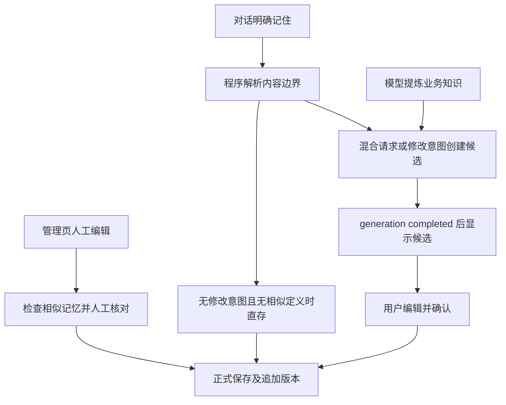
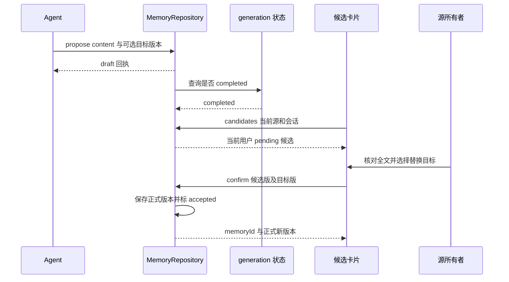

# 业务记忆保存、确认与复用指南

用途：追踪知识从管理页或对话进入正式记录、候选、固定版本快照和后续模型输入，解释权限、核对和版本冲突。适用读者：Memory 产品、API、Agent 与前端开发者。字段含义主要维护在 [数据模型设计](../design/data-model.md)，会话状态和临时约定见 [上下文与状态指南](context-and-state.md)。

## 1. Memory 的边界：保存知识不等于采用知识

当前正式 Memory 是同数据源范围内可跨会话使用的 `{name, description}` 业务知识，不是聊天摘要、所有查询结果或模型自行判断的事实。系统没有把每张表、指标、维度自动转换成专用知识实体，也没有向量检索持久化。

理解代码时要同时区分：

| 对象 | 存放位置 | 谁使其生效 |
| --- | --- | --- |
| 正式记忆 | memory 主记录及 revision 全文 | 管理页人工保存、明确记住直存、候选确认 |
| 候选 | memory_candidate | 只供核对，不能由模型确认；所属 generation completed 后用户才可操作 |
| 本轮知识快照 | analysis_state_draft.memories、内存 session.memories | Worker 开始时读取 active 精确版本，此后固定 |
| 已采用口径 | state.memoryRefs 的 id+version | Agent 读取定义后显式选择，选中全文才进入必选分析上下文和采用口径展示 |
| 临时约定 | state.temporaryNotes | 本任务使用并关联源消息，不写正式 Memory；可随当前任务跨轮继承 |

正式保存只说明知识进入可读目录，并不保证模型在任何问题中都使用它；采用口径也不能证明 SQL 必然贯彻了该定义，仍需看实际 SQL 和查询证据。

权限统一在 [MemoryRepository.authorize](../../packages/database/src/memory-repository.ts)：公共源、所有者和被共享用户可以读取正式记忆；**写入、列出候选和确认要求源所有者**。可读数据源不等于可写知识。前端隐藏写入口是体验控制，后端仍做授权；不可访问由 MemoryError 404 返回。

## 2. 三条保存入口



未匹配明确语法或指代不清时，程序不猜正式正文，交给模型澄清/提议。图只展示可能的保存路径，具体返回状态和失败边界如下。

## 3. 管理页：先核对相似项，再决定新增或替换

前端入口：[MemoriesView](../../apps/web/src/views/MemoriesView.vue) → [MemoryEditor.save](../../apps/web/src/components/MemoryEditor.vue) → [MemoryController](../../apps/api/src/memory/memory.module.ts) → [MemoryRepository.create / update / save](../../packages/database/src/memory-repository.ts)。

教学内容，不是项目自带定义：

```json
{
  "name": "成交额口径",
  "description": "成交额按支付成功金额统计，不扣除后续退款。"
}
```

用户点击“检查并保存”时：

1. Editor 去除两端空白，POST related，提交 datasourceId、content，编辑旧记录时带 excludeId。
2. related 读取该源 active 正式快照，返回最多 5 个同名/同内容/相似项。Editor 用正文与匹配 ID/版本/原因形成 fingerprint。
3. 首次发现匹配时停在核对状态，显示旧版正文和“替换这条记忆”；用户可选择目标，或在新增场景继续“仍然新增”。不是 related API 自动覆盖旧内容。
4. 用户再次提交且匹配 fingerprint 没变化，才 POST 新建或 PATCH 目标。若正文/来源上下文改变，核对状态清空；异步请求以 contextRevision 检查是否仍属于当前编辑上下文。
5. 新增在同事务插入主记录 version=1/active 和 revision 全文；修改锁主记录，检查 expectedVersion 后版本+1并追加 revision。前端收到回执再刷新目录。

相关匹配是文本提示：NFKC、小写、空白/标点归一化后比较，同名和同内容优先，其他使用字符二元组 Dice 分数，至少 3 个共同二元组、阈值 0.55；**不是 LLM 业务矛盾判断**。不同标题的定义即使业务矛盾也可能无匹配，相似文字也可能没有冲突。算法见 [relatedMemories](../../packages/database/src/memory-policy.ts)。

后端 create 不强制“先调 related 并核对”，它接受明确人工保存，主要强制内容结构、权限和同源 active normalized_name 唯一。即使 UI 选择“仍然新增”，同规范化标题仍会被唯一约束拒绝为 409；不同标题相似内容可以新增，是否合并由人判断。

正文只允许 name/description，不能为空；name 最长 200 字符、description 最长 4000 字符，额外字段拒绝。不能把任意 JSON 知识对象直接写入此接口。

## 4. 明确“记住”：哪些由程序直存，哪些进入核对

执行入口在 [AnalysisRuntimeAdapter.run](../../apps/worker/src/analysis/analysis-runtime-adapter.ts)的状态 begin **之前**：`prepareConversationMemory` 调 `parseMemoryIntent`，把 MemoryNotice 写入展示块并 checkpoint，随后才读取正式 Memory 快照。

[parseMemoryIntent](../../packages/database/src/memory-policy.ts)识别的是保守语法：消息开头“记住”及可选礼貌/内容词，后跟冒号或逗号。不是对任意自然语言做持久化意图分类。标题取已分离正文首行前 80 字，description 保留已分离正文。

| 教学输入 | 解析和处理结果 |
| --- | --- |
| `记住：成交额按支付成功金额统计。` | 内容明确、没有修改/混合请求；调用 rememberFromConversation。无相关旧定义可直存正式记录 |
| `记住：成交额按支付成功金额统计。然后分析最近七天。` | 分离长期正文与分析请求，mode=review；创建新候选，分析请求不会作为候选正文 |
| `记住：以后成交额改为扣除退款。` | 含“以后/改为”等修改意图，进入候选；解析器不自动找旧 Memory 并覆盖 |
| `记住：刚才那个口径。` | 指代不清，无 content，review_required；需模型澄清或提炼，程序不创建正式记忆 |
| `以后分析时参考上面的定义` | 不匹配此明确语法；无程序 MemoryNotice，模型若提炼仍只能 propose_memory |

直存路径 `rememberFromConversation` 先检查同源 revision 是否已有此 sourceMessageId；存在则返回该 Memory 当前正式版本，避免同源消息重复处理再新增。若该记录已删除，回 not_saved，不自动复活。来源检查是应用逻辑，不是单独的 sourceMessageId 唯一索引。

新内容与 active 旧记忆存在 related 匹配时，直存抛 MemoryReviewRequired，`prepareConversationMemory` 转为 propose。**这一步默认创建无目标的新候选**，不会依据文本相似度擅自选替换目标；后续用户可编辑并选旧记忆。

| MemoryNotice.status | 已发生的数据库事实 | 应如何理解前端提示 |
| --- | --- | --- |
| saved | 正式 memory/revision 已独立提交 | “已保存”，失败/取消不撤销，可到管理页修改或删除 |
| pending | candidate 已提交，正式记录未变 | 成功结束后核对候选；不重复提议，也不能说正式保存成功 |
| review_required | 内容边界/指代不明，没有确定写入 | 需要澄清或由模型提炼候选 |
| not_saved | 已知 MemoryError、权限/内容错误，或同消息对应知识已删除 | 以应用回执为准，模型正文“已记住”不能证明保存 |

上述已知 MemoryError 被转换为 notice；未知数据库异常继续抛出，可能使整轮执行失败，不保证所有错误都能降为 not_saved。回执内容进入 [MemoryNoticeBlock](../../apps/web/src/components/blocks/MemoryNoticeBlock.vue)，同时被加入 Prompt 的 memoryAction，约束模型不得重复提议或声称错误状态。

**直存在 begin 之前**，所以 saved 新记忆可进入**本轮**固定目录，但仍需选择 memoryRefs 才算采用。不能把“后续保存修改下一轮生效”的规则误用于这条启动前直存路径。保存事务独立于 generation finalize，查询失败、取消或后续 checkpoint 写失败不会撤销已保存记录。

依据：[prepareConversationMemory](../../apps/worker/src/analysis/prepare-conversation-memory.ts)、[rememberFromConversation](../../packages/database/src/memory-repository.ts)、[buildAnalysisPrompt](../../apps/worker/src/analysis/analysis-prompt.ts)。

## 5. 模型提议：可写候选，但不能写正式版本

模型工具 [ProposeMemoryTool](../../apps/worker/src/analysis/propose-memory-tool.ts)只有 propose_memory，没有正式 confirm/update/delete 操作。模型根据用户提供信息提炼可复用正文；Prompt 要求它不把查询结果或未验证推断当成业务事实，这个语义限制不等于数据库能够证明候选内容正确。

教学提议节选：

```json
{
  "content": {
    "name": "成交额口径",
    "description": "成交额按支付成功金额统计，并扣除已确认退款。"
  },
  "memoryId": "00000000-0000-4000-8000-000000000001",
  "expectedVersion": 2
}
```

这是修改已有 M v2 的候选。新增候选不传 memoryId/expectedVersion；只传 expectedVersion 或目标版本不是正整数会被拒绝。修改前 Agent 应 read_memory 核对本轮版本，不能只凭标题猜目标。

`MemoryRepository.propose` 在事务内锁 generation 并检查用户、源、writerToken、starting/running，再检查源所有权。目标必须同源 active 且当前 version 匹配，否则 404/409；来源消息由 generation.request_message_id 决定，不接受模型随意传 sourceMessageId。

同 generation 内相同 content、目标及目标版本返回已有候选；每 generation 最多 10 条候选。入库初始 status=pending、version=1，工具回执却用 status=draft，提醒尚未正式保存。**draft 是工具回执标识，pending 才是数据库候选状态。**

工具的已知 MemoryError 返回 succeeded=false、错误和状态，模型可据反馈处理；writer/任务停止检查失败不能当保存成功。

## 6. 候选可见和确认：两个版本锁与一个事务



候选保存时不等 generation 完成，但 [MemoryRepository.candidates / decide](../../packages/database/src/memory-repository.ts)读取/确认都 JOIN generation 并要求 completed。这里是执行状态，不要求 outcome 一定 complete；仅知识提议也可正常 completed。failed/cancelled 的候选不会列出或允许确认，也不会自动变正式记录。

[AnalysisBlock.loadCandidates](../../apps/web/src/components/blocks/AnalysisBlock.vue)在非 isStreaming 时请求，检查当前源所有者，带 conversationId，再以 sourceMessageId 匹配本条分析消息，避免把同会话另一轮候选挂错位置。管理页按源列出该用户待确认候选。界面等待流/文字展示结束不等于后端无需状态校验。

确认需要区分两个版本：

| 请求字段 | 检查对象 | 教学例子 |
| --- | --- | --- |
| expectedVersion | candidate 自身 version | 候选创建为 1，确认必须仍为 1 |
| expectedMemoryVersion | 正式目标 Memory 当前 version | 用户选替换 M v2，必须仍为 2 |

不编辑时 confirm 使用 candidate.content、原 memory_id/expected_version。编辑时可提交完整 content 并指定目标及 expectedMemoryVersion；当前实现对未提供目标使用候选原目标作回退，因此**针对旧 Memory 的候选不会因省略 memoryId 自动改成新增**。无目标候选可选择新增，或在 Editor 中选相关旧记忆替换。

确认事务锁 candidate，校验它仍 pending 且版本正确，再调用 save：新增正式 v1 或更新目标+1、追加 conversation 来源 revision，最后 candidate 变 accepted/version+1 并记录正式 result ID/version。任一验证失败，全部回滚，候选仍 pending。拒绝只改 rejected/version+1，不修改正式 Memory 或此前查询。

重复发送相同 confirm/reject 且带上一候选版本，可以返回既有结果；不同动作、过时更多的版本或状态冲突返回 409。该幂等回执仅匹配代码规定的上一版本，不是任意重复请求都成功。

## 7. 三个贯穿场景：正常、冲突、失败

### 正常：核对后替换旧口径

教学场景：M v2“不扣退款”，候选 C v1 希望“扣确认退款”。用户选择 M v2 并确认。事务把 M.version 改 3、插入 revision 3，C 改 accepted/version 2 并记录 result_version=3。UI 移除 C，显示保存回执；原查询、图表、analysis_context 中采用的 M v2 不被重写。

下一个 generation 快照包含 M v3；begin 发现旧 memoryRef M v2 不在快照，会移除引用、清空旧假设并提示重新选择。Agent 需读取 M v3、update_analysis_state 选择该版，并对条件变化的证据重新查询。**确认不是立即刷新当前结果的按钮。**

### 冲突：另一个窗口先更新了目标

用户打开 Editor 时 M v2，在确认前另一窗口保存到 v3。related 重新查询可能更新核对项；即使先前检查已经通过，save 仍锁主记录发现 expected 2 与当前 3 不符，返回 409，正式 v3 不被覆盖，C 仍 pending。

Editor 显示“记忆已变化，请刷新后重试”等错误，重置核对 fingerprint。维护者应重新读取正文和版本后让用户核对，不要盲目把 expectedVersion 改成最新值再次提交。候选自己的 version 已变化时也有另一种 409，即使正式目标没变化也不能忽略。

### 失败：提议已写入，但分析未 completed

propose 返回 draft 后，generation 因 SQL/模型失败或中止终结。候选行可能仍 pending 留在数据库，但 candidates 不返回它、decide 不接受它，正式记忆没变化。UI 无候选卡片不必然是“提议未执行”，先看所属 generation 状态。

如果同轮先执行明确直存并得到 saved，随后失败，则正式知识仍存在。这与候选不同。取消竞争造成执行 failed 的限制见 [Generation 生命周期指南](generation-lifecycle.md)，不应把所有取消结果假定为 cancelled。

## 8. 快照、采用与证据：本轮和下轮到底何时变化

[MemoryRepository.snapshot](../../packages/database/src/memory-repository.ts)单条查询取得 active 主记录当前版本全集；`AnalysisStateRepository.begin` 将它保存进 draft.memories。候选没有加入此集合。

[analysisTools](../../apps/worker/src/analysis/analysis-tools.ts)的 list_memories 对固定集合分页，每页最多 20 条，目录 description 只给前 200 字并标记截短；read_memory 按 ID 从同一数组读全文，管理 API 则可以直接读取当前/指定历史版。两个 read 入口不能混淆。

Agent 调 update_analysis_state 选择 memoryRefs 后，Adapter 把匹配版本全文加入必选分析数据；SQL Artifact.analysis_context 同时保存当时选中正文与 state。页面“采用的业务口径”来自分析元数据中匹配 memoryRefs 的 memories，不是每次渲染实时查询管理页当前版本。

| 变更发生时机 | 已启动 generation | 下个 generation |
| --- | --- | --- |
| 启动前明确直存 saved | 新记录进入这轮目录，但仍需选择采用 | active 则继续可读 |
| begin 之后管理页修改/删除 | 快照不刷新，仍按已冻结正文运行 | 更新版进入目录，删除项排除；旧精确引用失效 |
| 这轮 completed 后确认候选 | 既有报告/Artifact 不重算 | 新正式版可召回并重新选择 |
| 临时约定 | 可更新 state.temporaryNotes，本任务使用 | 同 task 可继承，不作为源级正式知识跨任务传播 |

“仅本次使用”按钮实际先 reject 候选，再 sendMessage 提交临时约定请求，要求当前会话且无活动任务。是两次操作，不是同一事务；拒绝成功而发送失败时，候选已关闭，用户需要重发约定。新请求由 Agent 更新状态并按需重查，不自动回写旧 SQL 或撤销原查询。

## 9. 版本历史、来源与删除

主记录保存当前 version/status，revision 追加全文；删除使用 DELETE 接口带 expectedVersion，但 Repository 实际追加 deleted revision、主记录软删除，active 列表和快照不再召回。历史全文仍可按 id+version 读取；record 会综合当前主记录 deleted 状态，因此旧 revision 的正文仍在，不等于当前可用知识。

管理页修改/删除的来源为 manual；明确直存和候选确认的新 revision 为 conversation，sourceMessageId 绑定原用户消息，confirmedBy 保存操作者。正式来源 UUID 没有 message 外键，会话删除后知识与版本保留，但源消息不能保证还能打开。候选随 generation/message 删除级联消失；正式 Memory 及历史随数据源删除级联移除。

只记录来源，不自动撤回来源提问中错误推断，也没有自动合并矛盾定义的任务。历史版本不可覆盖、源级共享和同源标题唯一一起构成当前维护边界。

## 10. 排查和修改入口

| 现象 | 先检查 | 主要代码 |
| --- | --- | --- |
| 数据源可见但没有保存按钮 | 是否源所有者，UI canWrite 与后端 authorize 是否一致 | [MemoriesView](../../apps/web/src/views/MemoriesView.vue)、[MemoryRepository](../../packages/database/src/memory-repository.ts) |
| 模型说已保存但找不到 | memory_notice 是 saved/pending/not_saved，正式列表的源和删除状态 | [prepareConversationMemory](../../apps/worker/src/analysis/prepare-conversation-memory.ts)、[MemoryNoticeBlock](../../apps/web/src/components/blocks/MemoryNoticeBlock.vue) |
| 出现相似项却仍可新增 | related 是提示；同标题唯一强制，不同标题相似可由用户新增 | [memory-policy](../../packages/database/src/memory-policy.ts)、[MemoryEditor.save](../../apps/web/src/components/MemoryEditor.vue) |
| 提议回执成功但无卡片 | generation 是否 completed、当前用户/源/会话/sourceMessageId 过滤 | [candidates](../../packages/database/src/memory-repository.ts)、[AnalysisBlock.loadCandidates](../../apps/web/src/components/blocks/AnalysisBlock.vue) |
| 保存返回 409 | 区分 candidateVersion、目标正式 version、同源 normalized_name 唯一冲突 | [decide / save](../../packages/database/src/memory-repository.ts)、[MemoryController](../../apps/api/src/memory/memory.module.ts) |
| 新口径没影响已运行结果 | 快照读取时机、memoryRefs 与证据采用版本，是否确实发起下轮并重查 | [Adapter](../../apps/worker/src/analysis/analysis-runtime-adapter.ts)、[AnalysisStateRepository.begin](../../apps/worker/src/analysis/analysis-state.repository.ts) |

修改明确记住语法时，联合检查 parseMemoryIntent、prepareConversationMemory 和 Prompt 对 notice 的解释；修改候选工作流时，联合检查 API 请求字段、Repository 两个版本锁、Editor 和 AnalysisBlock；扩展 Memory 正文结构时，联合更新 contracts、validateMemory、revision JSON、显示组件、相关匹配和 Prompt，不能只添加 UI 字段。

本文基于当前代码确认；业务定义是否正确仍由源所有者核对。没有证据证明的知识治理、审批角色或跨源知识库不应作为当前能力记录。
