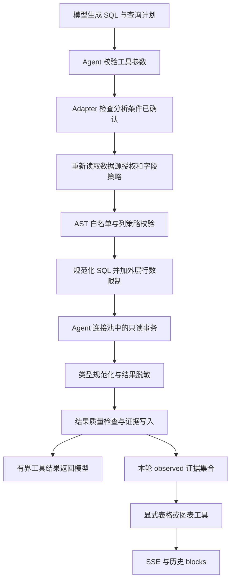

# SQL 查询、质量与 Artifact 实现指南

用途：理解模型生成的 SQL 怎样成为可追溯的查询证据，以及这份证据怎样进入结论、表格和图表。适用读者：Worker、数据分析、安全校验与结果展示开发者。

本文描述当前源码实现。后文的 SQL、表目录、字段策略和结果行均为**教学构造，未在数据库运行**；它们用于推演代码分支，不表示项目内存在这些业务表，也不表示已通过解析器或浏览器测试。整体职责见[数据分析引擎设计](../design/analysis-engine.md)，状态继承与修改见[上下文与状态指南](context-and-state.md)。

## 1. 先理解四种不同的“完成”

一次数据库查询成功，并不等于它已经支撑了最终答案。当前实现有几道相互独立的门槛：

| 判断 | 当前代码实际检查什么 | 不能据此推出什么 |
| --- | --- | --- |
| 查询成功 | SQL 已执行、结果已规范化和脱敏、Query Artifact 已写入，工具没有返回 `succeeded: false` | 不证明 SQL 符合业务口径，也不证明结果覆盖总体 |
| 证据适用 | 数据源、任务、条件签名、时效要求、访问指纹等符合当前状态 | 状态快照不解析 SQL 的业务语义，不能证明 WHERE 真正落实了全部条件 |
| 可以绘图或确认假设 | 无 `isLimited`，无 blocking 质量提示；图表字段存在且数值类型可用 | 不证明指标定义正确，也不证明前端已经完成渲染 |
| 已显式交付 | `display_query_table` 或 `generate_chart` 成功，或者正文回答已交付 | 图表/表格交付后，普通分析请求仍可能需要最终文字结论和 `finish_analysis` |

查询工具的普通 table 事件会被运行适配层过滤；因此“查到了两行但正文没有表格”可能是正常行为。查询可以只作为模型的证据使用，是否展示由展示工具明确决定。

## 2. 从模型参数到数据库的完整链路



按这个链路修改功能时，先分清职责归属：

| 入口与符号 | 主要责任 |
| --- | --- |
| [AnalysisAgent.run](../../apps/worker/src/analysis/analysis-agent.ts) | 校验可用工具、参数键、重复失败查询；将反馈交回主模型 |
| [AnalysisRuntimeAdapter.run](../../apps/worker/src/analysis/analysis-runtime-adapter.ts) 的 SQL 包装器 | 要求 `session.prepared`，复核源访问，把当前状态、已选 Memory 和访问指纹复制到 ToolContext |
| [SqlQueryTool.parseArguments / execute](../../apps/worker/src/chat/tools/sql-query.tool.ts) | 解析 title/sql/plan，组织查询活动、质量报告、Artifact 和模型输入 |
| [SqlExecutor.validate / execute](../../apps/worker/src/chat/tools/sql-executor.ts) | AST 安全校验、表列策略、外层限制、数据库执行、类型规范化和脱敏；不调用 LLM |
| [DatabaseClient.queryReadOnlyWithFields](../../packages/database/src/index.ts) | 使用 Agent 连接池、只读事务、单条语句超时和取消信号，返回 PG 行与字段元数据 |
| [ArtifactRepository.createQueryArtifact](../../apps/worker/src/chat/artifact.repository.ts) | 保存已处理行、执行 SQL、质量和分析条件快照，限制大小并生成内容哈希 |

`session.prepared` 表示模型已通过 `update_analysis_state` 确认或修改本轮条件。未准备时 SQL 包装器返回可修正反馈，不进入执行器。准备完成后，模型仍负责把状态里的时间、筛选和业务口径落实到 SQL；当前没有自动把状态转换成 SQL 条件的编译器。

## 3. 每一道防线保护什么

### 3.1 数据源授权与表目录

[SchemaService.getAllowedTableNames / getColumnPolicies](../../apps/worker/src/database/schema.service.ts) 不使用模型提供的表清单。执行时重新从平台的目录与策略读取允许访问的表，底层授权规则位于 [assertDatasourceAccess / getDatasourceColumnPolicies](../../packages/database/src/schema-access.ts)。

数据源创建者、被授权用户及 `created_by IS NULL` 的公共源可以访问；Agent 的物理表范围进一步由可见目录限定。平台自身数据库和分析物理表当前共享 PostgreSQL，这里的 datasourceId 是逻辑授权范围。`queryReadOnlyWithFields` 的 `_datasourceId` 参数不切换到另一个数据库连接。不能把“选中数据源”理解为建立了独立远程数据库连接。

即使启动时已加载 Schema，也会在真正查询前重新核对权限。若数据源权限已经撤销，执行器抛出 `DATASOURCE_ACCESS_CHANGED`，主 Loop 停止分析。

### 3.2 AST 检查决定 SQL 是否允许送入数据库

`SqlExecutor.validate` 使用 node-sql-parser 的 PostgreSQL 模式。它先解析，再检查：

1. 只允许一条 SELECT；多语句直接拒绝。
2. 递归检查 CTE、子查询和表作用域；CTE 内部也只能读取，物理表必须在目录中。
3. 显式 schema 只能是 public；拒绝 SELECT INTO 和锁定读取。
4. 拒绝源码列出的高风险函数，例如 pg_read_file、dblink、set_config 和后台取消/终止函数。这里是一个禁止函数集合，不能扩写为“所有函数均已按安全性审核”。
5. 按字段策略检查 wildcard、整行对象、被禁止字段和脱敏字段的使用方式。

解析器不能识别某段 PostgreSQL 语法时，返回 `SQL_VALIDATION_FAILED` 并说明未执行。这个错误与安全拒绝不同：模型可以尝试更简单的等价写法。具体可接受语法仍以当前解析器版本及实际 AST 为准。

### 3.3 字段策略不是只控制返回列

deny 字段不能被引用；mask 字段可以直接投影，随后对返回值脱敏，但不能参与表达式、聚合、去重、筛选、排序、分组或关联条件。代码还检查输出别名及排序位置，避免把受限字段换个名字后用于这些操作。

存在受限字段的相关表不能直接使用 SELECT * 或整行对象返回。脱敏字段的查询也不能包含 CTE、UNION 链、派生子查询、窗口或分组等结构。由此可见，脱敏是“限制原值可参与的查询 + 返回值替换”两部分，不能只在前端显示时遮盖。

以下例子假定目录仅允许教学表 teaching_result，字段 day、volume 为 allow，phone 为 mask/last4，secret 为 deny。例子均未运行：

| 构造 SQL | 按源码规则推演 |
| --- | --- |
| `SELECT day, volume FROM teaching_result ORDER BY day` | 没有引用受限字段；仍须通过实际解析与数据库类型检查 |
| `SELECT day, volume, phone FROM teaching_result ORDER BY day` | phone 为直接列，排序不使用 phone；执行后 phone 被脱敏 |
| `SELECT * FROM teaching_result` | 受限字段存在时拒绝 wildcard |
| `SELECT secret FROM teaching_result` | 引用 deny 字段，安全拒绝 |
| `SELECT COUNT(DISTINCT phone) FROM teaching_result` | 脱敏字段参与派生计算，安全拒绝 |
| `SELECT phone AS p FROM teaching_result ORDER BY p` | 输出别名继续受限制，安全拒绝 |
| `SELECT day FROM teaching_result WHERE phone = '示例值'` | mask 字段用于筛选，安全拒绝 |
| `SELECT day FROM other_table` | 物理表不在允许目录，安全拒绝 |
| `SELECT day FROM private.teaching_result` | 非 public schema，安全拒绝 |
| `SELECT day FROM teaching_result FOR UPDATE` | 锁定读取，安全拒绝 |
| DELETE 或两条 SELECT 拼接 | 操作类型或语句数量不符合规则，安全拒绝 |

这些拒绝不是要求模型“换一个更隐蔽的写法”。`SQL_SECURITY_REJECTED` 会结束本轮分析，用户得到无法完成说明。

### 3.4 数据库只读事务与超时

AST 校验通过后，执行器用 `parser.sqlify` 重建 SQL，再统一包成：

```sql
SELECT * FROM (<规范化后的 SELECT>) AS "__gist_result" LIMIT 1000
```

外层限制适用于原 SQL 已有 LIMIT 或 UNION 的情况。original_sql 保存模型提交的文本，executed_sql 保存真正发送给数据库的包装文本；排查查询时以实际执行文本为准。

底层顺序是：从 agentPool 取连接 → BEGIN READ ONLY → SET LOCAL statement_timeout 为 15000ms → 记录 backend PID → 执行查询 → 无论成功失败都 ROLLBACK 并释放连接。只读事务提供数据库层的写入防线，AST 则先限制可访问的表列及语法；两者承担不同职责。

取消信号触发后，代码尝试通过另一条 Agent 池查询调用 pg_cancel_backend。若 signal 已取消，返回的错误以取消原因优先。15 秒是单次查询的数据库超时，不能当作整个 Generation 的最长耗时；Generation 的取消与运行期限见[执行生命周期指南](generation-lifecycle.md)。

`normalizeSql` 仅在有绑定参数时把 ? 转为 $n，跳过字符串、注释和美元引用。当前 Agent 查询没有值参数，执行器传的是空数组，因此不走这个占位符转换。动态标识符应使用标识符转义，不能用值占位符替代表名或列名。

## 4. 用同一份结果推演数据如何变化

继续使用上述教学表，构造查询：

```json
{
  "title": "读取每日数量",
  "sql": "SELECT day, volume, phone FROM teaching_result ORDER BY day",
  "plan": {
    "purpose": "核对每日数量及明细范围",
    "expectedGrain": "day",
    "expectedShape": "timeseries"
  }
}
```

为了解释转换，假定 PostgreSQL 驱动返回以下值和字段类型。它们是构造输入，未执行真实查询：

| 字段 | PG 类型标识 | 第 1 行驱动值 | 第 2 行驱动值 |
| --- | --- | --- | --- |
| day | 1184，带时区 timestamp | Date 对象，代表 2026-10-01T00:00:00.000Z | Date 对象，代表 2026-10-02T00:00:00.000Z |
| volume | 1700，numeric | 字符串 `"12.50"` | 字符串 `"7"` |
| phone | 25，text | 字符串 `"12345678"` | null |

### 4.1 类型规范化

`normalizeRows` 使用 PG 字段元数据和非空值共同判断类型。numeric 字符串只有通过 `isLosslessNumber` 后才转成 number；整数还要满足安全整数与 BigInt 一致性检查。构造的 12.50 文本规范化为数字 12.5，7 文本为数字 7；Date 对象转为 ISO 字符串。

如果 numeric/bigint 某个非空值不能安全转成 JS number，例如超出安全整数范围的整数文本，该列会标记为 unknown，不执行该列的数值转换。后续图表要求 y 字段为 number，所以这种列不能因为“数据库类型是数字”就直接绘图。null 会保留，不会统一替换成零。

### 4.2 脱敏在模型和持久化之前

`applyColumnMasks` 按输出列名使用 AST 产生的策略映射。last4 输出 *** 加末四位；hash 输出 SHA-256 的前 12 个十六进制字符；redact 输出 [REDACTED]。null 保持 null，脱敏后的列类型设为 string。

此时同一份行数据变为：

```json
[
  {"day":"2026-10-01T00:00:00.000Z","volume":12.5,"phone":"***5678"},
  {"day":"2026-10-02T00:00:00.000Z","volume":7,"phone":null}
]
```

这份**规范化且脱敏后的数据**用于质量检查、Query Artifact、模型工具结果和后续展示。应用层数据库驱动最初拿到过原始值，不能据此描述为“原值从未进入服务端”；代码保证的是后续这些输出路径使用处理后的行。

### 4.3 模型看到的行与 Artifact 保存的行

`SqlQueryTool.execute` 按实际行 JSON 的字符长度累加模型输入。活跃分析上下文下上限为 16,000 字符；底层工具另有无分析上下文时的 60,000 字符分支。限制针对行数组累计尺寸，不是整个工具响应的总 token 上限，也不是“固定只给前 20 行”。本例两行都能进入 data。

如果数据库返回 700 行而行文本只容得下前 80 行：

- Artifact 仍保存数据库已返回的 700 行。
- 模型 data 只包含前 80 行，returnedRowCount 仍是 700。
- 质量报告增加 blocking 的 TOOL_RESULT_TRUNCATED，同时提供禁止用子集推断全集的说明。
- 不能把 80 行当作总体重新计算总量、排名或比率；应查询合适的聚合结果，或在理解边界后回读证据。

另一个上限发生在数据库返回阶段：外层 LIMIT 最多返回 1000 行，Artifact 不可能替你保存没有返回的其余源数据。“完整 Artifact”指完整的已返回结果，不等于完整源表。

### 4.4 查询计划怎样参与质量检查

plan.purpose 主要用于证据说明；expectedGrain 和 expectedShape 记录预期结果形态。当前 [assessResultQuality](../../apps/worker/src/chat/result-quality.ts) 实际检查的是：

| 信息 | 当前算法 | 使用边界 |
| --- | --- | --- |
| 空值比例 | 对每个返回列计算 null/undefined 比例 | 全为空为 warning，部分为空为 info；不自动决定应填零还是过滤 |
| 空结果 | 返回 0 行则 EMPTY_RESULT/warning | 不允许直接解释成业务值为零 |
| 返回限制 | isLimited 为真则 RESULT_LIMITED/blocking | 禁止由样本推断总体 |
| 模型行截断 | 工具行子集小于已返回行则 blocking | Artifact 行完整也不会自动消除此提示 |
| 粒度重复 | 找出列名在 expectedGrain 文本中出现的列，串联值并检查重复 | 如果计划写“每天”而列名为 day，可能无法识别粒度列；不是任意主键或 JOIN 放大证明 |
| 时间范围 | 找第一列 type=date，用可解析的字符串推导 min/max，声明 UTC | 不证明过滤覆盖用户目标区间；不把业务时区自动转换成正确查询 |

本例 expectedGrain=day 能匹配 day 列，两个日期不重复；phone 有一半空值，产生 info；day 推导 UTC 范围和 TIMEZONE_ASSUMED info。假定没有行限制或模型截断，则没有 blocking，volume 可作为图表数值。

expectedShape=scalar 并没有单独强制只返回一行，timeseries 也没有自动验证时序完整、日期连续或全部指标语义。因此不要把 plan 当作执行计划或严格结果 Schema。它不是数据库 EXPLAIN，也不会由它自动生成查询。

isLimited 目前通过 `extractLimit` 在实际 SQL 中寻找第一个 LIMIT 数字，再比较返回行数；若内层也有 LIMIT，可能读到内层值。例如内层 10000、外层 1000 时，返回 1000 行仍可能被标成未限制。这个限制判断的边界要与[问题记录](risks-and-open-questions.md)一起理解，不能在文档中保证截断检测完全可靠。

## 5. Query Artifact 怎样保存证据

`createQueryArtifact` 对结果行做稳定 JSON 序列化：对象键排序，数组顺序保留。行 JSON 超过 5 MiB 时拒绝保存；这个字节限制与模型的字符限制不同，也不是整个数据库记录的总大小限制。查询已执行成功但证据保存失败时，工具仍不算成功完成。

本例两行写入 query_artifact.result_rows，同时记录这些关键字段：

| 字段或字段组 | 用途与后续读取者 |
| --- | --- |
| generation/user/conversation/datasource IDs | 标识执行来源、用户、会话和逻辑数据源；证据读取与跨轮复用用这些身份校验 |
| purpose / expected_grain / expected_shape | 保存 plan，供依据面板及质量解释使用 |
| original_sql / executed_sql | 区分模型提交和安全规范化后的查询，供 SQL 展示与问题定位 |
| columns_json | 保存输出列名和规范化类型；表头与图表字段检查依赖它 |
| returned_row_count / total_row_count / is_limited | 已返回规模与限制提示；当前 SQL 工具没有计算总体行数，total_row_count 不应被假定总有值 |
| result_quality | 记录空值、截断、粒度、时间等质量信息；不是完整业务正确性证明 |
| result_content_hash | 对稳定序列化的已处理 result_rows 做 SHA-256，标识这份内容；不包括 SQL、状态或权限策略 |
| analysis_context | 查询当时的状态、选中 Memory 内容和 accessFingerprint；条件变化后复用判断使用快照 |
| schema_context_version | 记录 Schema 上下文策略版本；不能把这个字符串单独理解为当前物理 DDL 的内容哈希 |
| created_at / expires_at | 查询证据创建时间及读取有效期；Artifact 回读不会刷新源数据库 |

result_content_hash 当前写入并可随事件/对象携带，已核对的回读与绘图代码没有重新计算并验证它。accessFingerprint 则是对允许表名和列策略做稳定序列化后的哈希，用来检测目录/字段权限变化；两者不能替代。

证据写入前后都有 assertWritable。携带 writerToken 时，`ArtifactRepository.writeArtifact` 在事务中锁定 Generation，并确认 token、用户、会话及 starting/running 状态，才写新证据；取消或旧 writer 丢失写入权时不能继续保存。底层仓库允许无 token 的调用分支，当前运行适配层明确要求 token。详细竞争时序见[执行生命周期指南](generation-lifecycle.md)。

## 6. 回读、展示和绘图为什么要重新检查

### 6.1 本轮 observed 与历史适用性

SQL 工具返回成功后，Adapter 读取 Artifact 元数据并加入 session.observed。它表示本轮实际查询或回读过的证据，不能仅凭模型说出某个 Artifact ID 就绕过观察过程。

回读链路先检查用户、会话、数据源现有授权和有效期；历史证据还要求所属 conversation_turn 为 completed。Adapter 继续检查当前数据源和访问指纹。[evidenceMismatch / conditionSignature](../../apps/worker/src/analysis/analysis-state.ts) 再判断：

- 数据源和 taskId 是否相同；不同任务的证据不能直接复用。
- freshness 为 current_generation 时是否来自本轮。
- Memory ID/version、临时约定、时间区间、对比区间、filters 和 grain 是否一致。

revision 不直接进入条件签名。因此单纯增加 openQuestions 等字段、没有改变查询条件时，旧证据不必因为版本数字变化就失效；改变筛选或 Memory 版本则需要重新查询。该签名是状态对象比较，不是 SQL 语义比较。

read_query_artifact 默认每次回读 20 行，offset 分页，每页行 JSON 超过 16,000 字符会拒绝返回。mode=comparison 允许在同源、同任务、允许复用的前提下读取不同历史条件的证据，并标明 comparisonOnly；它不更新数据库，也不会让不匹配的证据通过当前图表检查。

### 6.2 显式表格保留范围说明

display_query_table 要求证据在本轮 observed 中，再读取身份/权限与条件。它发送的主正文事件主要是 display=true、queryArtifactId、会话和标题，行数据由前端按需加载。

该工具没有像绘图一样一律拒绝 limited/blocking 证据，因为用户可能需要查看样本或问题明细；返回数据和前端质量提示必须保留边界。它展示成功不意味着可以用样本证明总体结论。

### 6.3 图表数值由程序取自证据

[GenerateChartTool.parseArguments / execute](../../apps/worker/src/chat/tools/generate-chart.tool.ts) 接受 Artifact ID、图表类型和字段映射，不接受模型自己提交数值数组。执行顺序是：

1. Loop 要求该证据在此次工具批次开始前已被观察，查询和立即引用它绘图不能依赖同一批工具的执行顺序。
2. Adapter 要求 prepared、证据权限和条件匹配，且没有 limited 或 blocking。
3. 工具再次读取存储行和元数据，确认 x/y 字段存在；所有 y 必须为 number，scatter 的 x 也必须为 number。pie/funnel 只能有一个 y。
4. 根据 sort 在存储行上确定性排序，构建 xAxis 与 series，写入 Chart Artifact 的引用和映射。
5. writer 再校验后发送包含真实 chartData 的 chart 事件。

在本例中，构造映射 xField=day、yFields=[{field:volume,label:数量}]，得到：

```json
{
  "chartType":"line",
  "title":"教学日期趋势",
  "xAxis":["2026-10-01T00:00:00.000Z","2026-10-02T00:00:00.000Z"],
  "series":[{"name":"数量","data":[12.5,7]}]
}
```

phone 不作为 y 值，也没有原值进入图表。上述载荷只是代码推演，没有浏览器验收。工具返回的 status=rendered 表示服务端已产出并发送图表数据；真正的 ECharts option、resize 和主题适配在 [ChartBlock.buildOption / renderChart](../../apps/web/src/components/blocks/ChartBlock.vue)。

### 6.4 前端分页读取的是证据快照

[AnalysisArtifactController.metadata / rows](../../apps/api/src/analysis-artifact/analysis-artifact.module.ts) 对每次读取检查用户、会话、数据源授权、有效期和当前访问指纹；指纹失效返回 409，提示重新查询。rows 的 cursor 是 JSONB 行数组偏移量字符串，默认 50 行、最大 100 行。

[AnalysisArtifactTable.load](../../apps/web/src/components/blocks/AnalysisArtifactTable.vue) 首先读元数据，再读 limit=100 的第一页；追加页拼接已有行。本例只保存两行，第一页返回两行且 nextCursor=null。分页不会重新执行 SQL，也不延长数据新鲜度。历史 chartData 则从 message.blocks 直接恢复，不是每次重新调用 Artifact API，权限路径区别见[前端流式指南](frontend-streaming.md)。

## 7. 失败反馈怎样改变 Agent 下一步

| 失败位置 | 返回与控制流 | 开发者应查看 |
| --- | --- | --- |
| 工具 JSON、参数键、plan 枚举、未准备状态 | 可修正反馈交回主 Loop；通常尚未执行 SQL | Agent 参数校验、工具 parseArguments、update_analysis_state |
| Parser 无法识别或 sqlify 失败 | SQL_VALIDATION_FAILED，明确未执行，retryable=true | 原 SQL 与解析失败位置；优先简化语法 |
| PG 42601/42703/42P01/42803/42702 | 分别为语法、字段、表、分组、歧义；SQL 工具返回 retryable=true | 已加载 Schema、实际 SQL、别名和分组 |
| PG 57014，signal 未取消 | 单条查询超时，提示缩小范围，交回模型修正 | 过滤范围、聚合粒度、查询资源成本 |
| SQL_SECURITY_REJECTED 或 DATASOURCE_ACCESS_CHANGED | 主 Loop 安全停止；业务 outcome 为 unable_to_complete，后续同批工具跳过 | 目录、列策略、AST 拒绝原因；不以改写绕过限制 |
| signal 取消、writer 失去所有权 | 退出执行，不发布新证据；由生命周期终结任务 | 取消/超时来源和 writer 状态 |
| 未列入可恢复表的 PG 错误、未知异常、证据持久化失败 | 通常包装为 TOOL_EXECUTION_FAILED 并让 Generation failed | 最初异常与仓库写入点，不能只依赖 UI 的通用错误 |

同一 SQL 文本与错误码累计失败两次后，AnalysisAgent 将该 SQL 加入 blockedQueries；模型需要真正修改查询，而不是无限重试原文。连续三次重复相同操作另有 ANALYSIS_NO_PROGRESS 防护。底层存在 ARTIFACT_RESULT_TOO_LARGE 专用错误，但 SQL 工具的 catch 可能把它转成通用工具失败，因此不要保证底层错误码原样到达 UI。

安全停止是一种业务“无法完成”结果，可能正常完成 Generation 的收尾；基础设施工具失败则可能令 Generation failed。业务 outcome 和任务运行状态是两套维度，不能用一个“查询失败”概念替代全部分支。

## 8. 修改与排查的实际入口

| 症状或改动 | 建议的阅读与判断顺序 |
| --- | --- |
| SQL 没有进数据库 | 先看 prepared 和工具参数，再看 AST 拒绝；解析失败与安全拒绝要分别处理 |
| 执行成功但模型没有足够数据 | 比较 returnedRowCount、模型 data 行数与 toolResultTruncated；分页浏览不是总体统计的替代 |
| 查询成功但正文没表格 | 检查是否调用 display_query_table，以及事件 display=true；普通 table 被 Adapter 过滤 |
| 字段是 numeric 却不能绘图 | 查 columns_json 的实际类型与原字符串安全转换，不先强制 Number |
| 旧证据突然不能读取或绘图 | 查数据源授权、expires_at、accessFingerprint、taskId、conditionSignature、freshness |
| 图表数据显示与预期不同 | 先比 Artifact 行和字段映射，再查排序及 ChartBlock 的 option；不要只核对模型文字 |
| 修改结果上限或质量规则 | 同时核对 ensureLimit、isLimited、模型行截断、Artifact 大小、读取分页和质量提示的含义 |
| 增加图表类型 | 同步工具枚举、共享 ChartType、数据库 CHECK、前端 ChartData/buildOption；只改模型 Prompt 不足以落地 |
| 调整字段策略 | 同时检查 Schema 对模型的可见性、AST 引用校验、脱敏输出和历史证据指纹；避免只改一个展示层 |

本指南为静态源码分析与教学推演，未执行真实分析查询、外部服务调用、浏览器 E2E 或交互验收。
